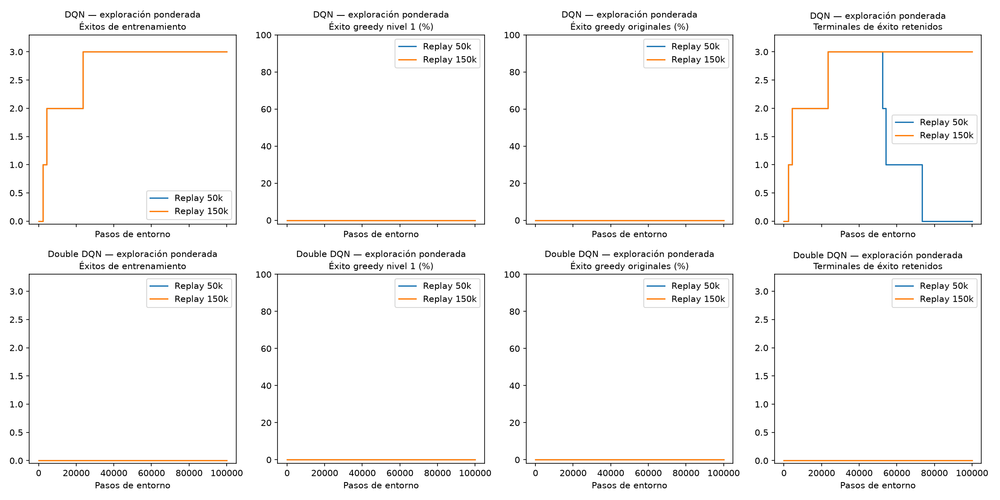
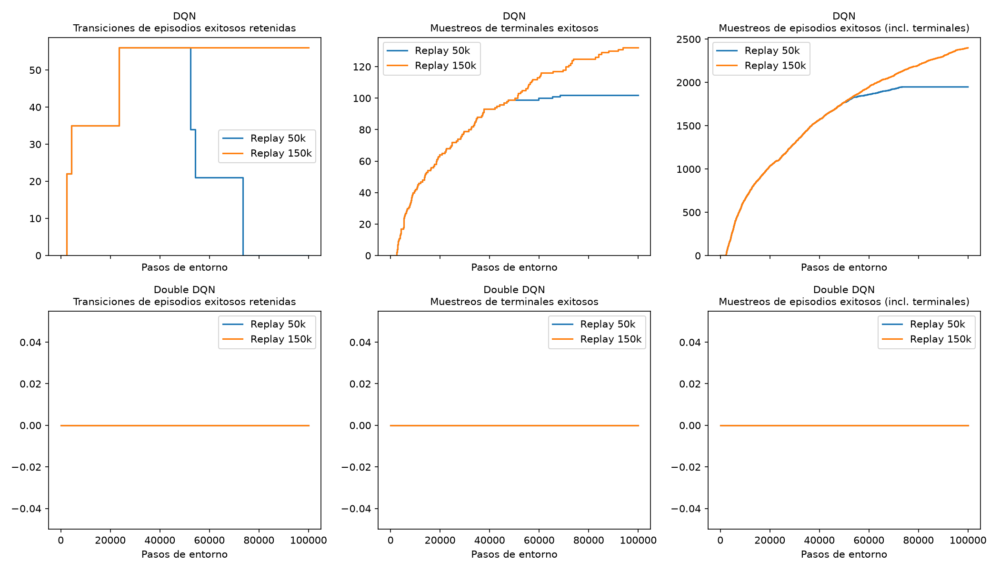
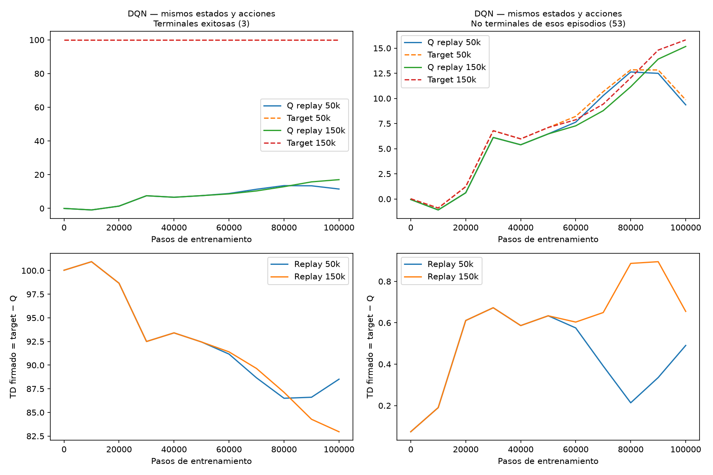
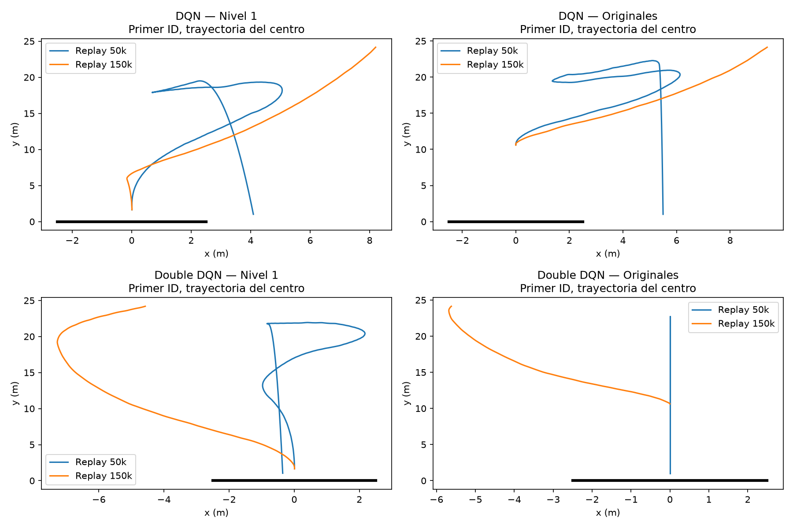

# Ablación de capacidad: replay 150 000 frente a 50 000

**Conservar las experiencias tempranas no bastó para aprender a aterrizar.**
Se ejecutaron DQN y Double DQN desde cero, 100 000 pasos por algoritmo, con
exploración ponderada y cambiando únicamente `buffer_capacity` a 150 000.
DQN reprodujo sus tres éxitos tempranos y conservó sus 56 transiciones; Double
DQN siguió sin éxitos. Ambos obtuvieron cero aterrizajes greedy en todos los
puntos de validación, tanto en nivel 1 como en las condiciones originales.
No se ejecutó otra ablación, campaña de semillas ni prueba final.

Experimento: `replay150k_weighted_seed42_100k_v1`. Referencias: las ejecuciones
`dqn_weighted_variant` y `double_dqn_weighted_variant` de
`exploration_comparison_level1_seed42_100k_v1`. Ambas capacidades usan una
**variante de exploración ponderada**, no exploración DQN estándar.

## Protocolo y comprobación de identidad

Los JSON `dqn_replay150k.json` y `double_dqn_replay150k.json` difieren de sus
referencias solo en capacidad. Permanecen LR=0,0001, `SmoothL1Loss(beta=10)`,
gamma=0,99, Adam, MLP 128/128 ReLU, batch 64, clip 10, warmup 1000,
aprendizaje cada 4 pasos, copia objetivo cada 500 y 100k pasos totales. La
exploración conserva p=[0,35;0,15;0,025;0,025;0,35;0,025;0,025;0,05],
y epsilon 1→0,1 en los 80k pasos posteriores al warmup, sin reinicios.
Recompensa v1, física, gas inicial 18 000 N·s, catálogo y éxito no cambiaron.
Mismos 128 estados de entrenamiento L1 y selector/RNG inicial; mismos 32 casos
reservados de cada nivel y 32 originales, evaluados greedy inicialmente y cada 10k.
El mejor checkpoint sigue seleccionándose por éxito L1, error entre éxitos y
primer empate; quedaron en 10k, sin éxito. Las tablas finales usan `last` a 100k.

Antes de entrenar se verificó numéricamente para ambos algoritmos que las redes,
RNG de política y replay, minibatches y actualizaciones son iguales mientras la
población del replay es igual. El observador registra índices y Q/targets ya
calculados: no hace sorteos, no altera tensores, gradientes ni probabilidades.
El sampler sigue siendo `rng.choice(size, batch_size, replace=False)`.

Se pausó cada **nueva ejecución** a 50k, conservando el episodio vivo, para comparar
contra el checkpoint histórico de capacidad 50k. Coincidieron exactamente:

- Todas las decisiones, estados, recompensas y éxitos de los primeros 50k pasos.
- Redes principal/objetivo, Adam, población del replay y contadores.
- RNG usados por política, replay, entorno, NumPy global, Python y Torch CPU.
- Todos los IDs muestreados en las 12 251 actualizaciones de ese prefijo.

DQN reprodujo los éxitos en **2324, 4257 y 23468**; Double DQN reprodujo cero.
Después se continuó desde el checkpoint **del mismo experimento nuevo**, sin
reiniciar red, optimizador, replay ni episodio, hasta 100k. No se cargaron pesos
históricos para entrenar, no se reentrenó la referencia y no se duplicaron los
50k del prefijo. Son dos corridas de 100k, registradas en dos segmentos cada una.

La comprobación inicial se detuvo al comparar un RNG auxiliar de `action_space`:
el código histórico lo inicializa con entropía del sistema al guardar checkpoints,
y estas políticas nunca usan `action_space.sample()`. Se documentó ese campo,
se verificaron los RNG activos y se continuó desde el prefijo ya completado,
sin repetir interacciones. No hubo diferencia de trayectorias o éxitos. Se
conservan el comparador inicial y su log; `prefix_verification.json` registra
explícitamente `unused_action_space_rng_equal=false`.

Al paso 50 001 las poblaciones empiezan a diferir; el primer minibatch distinto
es el de **50 004**. La primera acción distinta aparece en 50 038 para DQN y
50 072 para Double DQN. La puerta epsilon y las acciones exploratorias siguen
siendo idénticas a la referencia durante los 100k: el RNG de política es independiente
del de replay. Las diferencias posteriores corresponden a las elecciones greedy
tras aprender con muestras diferentes.

## Resultados a 100k y exposición de éxitos

| Algoritmo / capacidad | Episodios completos | Éxitos entrenamiento | Greedy L1 | Greedy originales | Terminales exitosos retenidos | Transiciones de episodios exitosos retenidas |
|---|---:|---:|---:|---:|---:|---:|
| DQN 50k, referencia | 1058 | 3 | 0/32 | 0/32 | 0 | 0 |
| DQN 150k, nuevo | 1187 | 3 | 0/32 | 0/32 | 3 | 56 |
| Double DQN 50k, referencia | 997 | 0 | 0/32 | 0/32 | 0 | 0 |
| Double DQN 150k, nuevo | 1067 | 0 | 0/32 | 0/32 | 0 | 0 |

Nivel 2 y nivel 3 también permanecieron en 0/32 en todos los checkpoints.
No se oculta el resultado L1/originales dentro del agregado. Los nuevos episodios
parciales finales no se cuentan como terminados ni como aterrizajes.
[Tabla completa](resultados/replay150k_resultados.csv).

Los tres episodios exitosos DQN son los mismos: episodios 58/110/476,
casos `curriculum-train-l1-109/082/111`, de 22/13/21 transiciones. Los dos primeros
son enteramente exploratorios; el tercero mezcla 18 acciones exploratorias y
3 greedy. No apareció un éxito nuevo después de 23 468 ni se reprodujeron
aterrizajes sin exploración. Las etiquetas de episodio se asignan **solo para
análisis**, cuando se conoce su terminación; no entran en la red ni en el sampler.

| Exposición DQN durante todo el entrenamiento | Replay 50k | Replay 150k |
|---|---:|---:|
| Muestreos de terminales exitosos | 102 | 132 |
| Actualizaciones que incluyeron un terminal exitoso | 102 | 132 |
| Muestreos de cualquier transición de esos episodios | 1948 | 2400 |
| Actualizaciones con alguna transición de esos episodios | 1786 | 2229 |
| Muestreos antes de conocer el desenlace del episodio | 2 | 2 |
| Muestreos desde que se conoció el desenlace | 1946 | 2398 |

Los terminales son un **subconjunto** de las transiciones de episodios exitosos:
no deben sumarse ambas filas. Un muestreo es una inclusión en un minibatch usado
para una actualización; una transición puede contarse muchas veces. Cada corrida
realiza 24 751 actualizaciones de 64 muestras, 1 584 064 inclusiones en total.
Double DQN tiene cero en estas filas con ambas capacidades.

| Transición terminal exitosa, paso | 50k: veces muestreada | 150k: veces muestreada |
|---|---:|---:|
| 2324 | 55 | 64 |
| 4257 | 37 | 49 |
| 23468 | 10 | 19 |

La referencia termina sin éxitos en replay; el buffer nuevo conserva todos los
100 000 pasos porque no alcanza su capacidad de 150 000. La mejora de retención
produce 30 inclusiones terminales adicionales y 452 inclusiones adicionales de
transiciones de esos episodios, no un aumento proporcional a la capacidad máxima.
[Conteo por transición](resultados/replay150k_exposicion_por_transicion.csv) y
[retención/exposición por checkpoint](resultados/replay150k_retencion_exposicion.csv).

Los conteos nuevos proceden de los **índices realmente sorteados**. Para la referencia
histórica se reconstruyó el sampler desde su semilla 43 y tamaños conocidos,
verificando su estado RNG contra los diez checkpoints, incluido 100k. No se ejecutó
entrenamiento adicional para reconstruirlos. Sus Q/targets por actualización no
se guardaron históricamente: se dejan ausentes, no se inventan. La comparación
numérica temporal usa checkpoints reales sobre transiciones fijas compartidas.





## Q, targets y TD de las experiencias exitosas

Sonda fija: las **mismas 56 transiciones** de los tres episodios de referencia,
con sus estados/acciones/recompensas originales, en todos los checkpoints de ambos
tamaños. No se insertó la sonda en ningún replay. Los targets terminales son su
recompensa completa (bonus y costos del paso), sin bootstrap. En las 53 transiciones
no terminales se usa el target DQN/Double DQN del checkpoint, sin gradientes.
Se conservan IDs, valores individuales, medias y percentiles firmados.

Medias de las tres transiciones terminales exitosas DQN:

| Paso del modelo | Q 50k | Q 150k | Target, ambos | TD 50k | TD 150k |
|---|---:|---:|---:|---:|---:|
| 10k | −0,951 | −0,951 | +99,986 | +100,937 | +100,937 |
| 50k | +7,538 | +7,538 | +99,986 | +92,449 | +92,449 |
| 60k | +8,817 | +8,583 | +99,986 | +91,169 | +91,403 |
| 100k | +11,472 | +17,029 | +99,986 | +88,515 | +82,957 |

TD=target−Q. Hay menor error en esta sonda terminal a 100k, pero sigue siendo
grande y **no se traduce en control greedy exitoso**. La mayor capacidad tampoco
mejora de manera uniforme cada punto intermedio. No se interpreta un TD no terminal
pequeño como prueba de Q correcto: sus targets dependen de estimaciones bootstrap.

En los usos reales de terminales exitosos del replay nuevo, las medias Q/target/TD
fueron −0,586/+99,995/+100,581 en 41 inclusiones hasta 10k;
+3,501/+99,991/+96,491 en 58 entre 10k y 50k; y
+10,339/+99,985/+89,646 en 33 después de 50k. Estas últimas son observaciones de
muestreo con mezcla variable de transiciones; para comparar los mismos estados
se utiliza la tabla fija anterior. [Muestreos reales antes de actualizar](resultados/replay150k_muestreos_terminales_exitosos.csv).



Se conserva además la sonda histórica de 128 transiciones (64 terminales fallidas,
64 no terminales). Sus resultados finales, fuera de la distribución actual de L1:

| Algoritmo / capacidad | Q terminal medio | TD terminal firmado medio | MAE terminal | TD no terminal firmado medio | MAE no terminal |
|---|---:|---:|---:|---:|---:|
| DQN 50k | −108,605 | +8,533 | 51,528 | +0,010 | 0,897 |
| DQN 150k | −85,152 | −14,920 | 38,189 | +0,640 | 1,056 |
| Double DQN 50k | −123,912 | +23,840 | 59,737 | +0,251 | 1,534 |
| Double DQN 150k | −83,169 | −16,904 | 36,570 | +0,888 | 1,328 |

Son errores respecto a targets/recompensas de esas transiciones, no un error exacto
respecto a Q óptimo. [Valores fijos firmados y percentiles](resultados/replay150k_q_td_fijos.csv).
También se analizaron 128 minibatches uniformes de 64 de cada replay final y se
aplicaron **ambos modelos a los mismos índices de cada fuente** para separar
cambio de modelo de cambio de datos. [Diagnóstico cruzado por fuente y terminalidad](resultados/replay150k_diagnostico_replays.csv).
Los CSV locales conservan gradientes ponderados y cosenos de los grupos terminal/no
terminal; no se infiere contribución al aprendizaje solo de la magnitud TD.

## Fallos y contacto: L1 y originales separados

Resultados greedy finales, métricas de contacto únicamente donde existe:

| Modelo | Conjunto | Resultado / 32 | vy contacto (m/s) | |x| contacto (m) | Duración media (s) | Consumo medio (N·s) |
|---|---|---|---:|---:|---:|---:|
| DQN 50k | L1 | 26 fuera plataforma, 6 inválidos | −19,526 | 4,497 | 20,310 | 18000 |
| DQN 150k | L1 | 32 techo, sin contacto | — | — | 9,050 | 9300,2 |
| DQN 50k | Original | 31 fuera plataforma, 1 inválido | −19,955 | 5,203 | 20,323 | 18000 |
| DQN 150k | Original | 32 techo, sin contacto | — | — | 5,150 | 5507,2 |
| Double DQN 50k | L1 | 12 fuera plataforma, 20 inválidos | −20,103 | 1,671 | 20,374 | 18000 |
| Double DQN 150k | L1 | 32 techo, sin contacto | — | — | 7,309 | 7423,2 |
| Double DQN 50k | Original | 6 fuera plataforma, 26 inválidos | −20,337 | 0,947 | 20,379 | 18000 |
| Double DQN 150k | Original | 32 techo, sin contacto | — | — | 5,385 | 5504,9 |

Orientación, vx y velocidad angular al contacto de la referencia están desglosadas
por resultado en el [CSV de causas/contacto](resultados/replay150k_resultados_por_causa.csv).
Para 150k esos campos quedan ausentes en la validación final: salir por el techo
no es aterrizar. Su menor duración/consumo no representa mejor control.
En entrenamiento, los contactos fueron DQN 258→229 y Double 268→237 al pasar de
50k a 150k; episodios con gas agotado 29→0 y 31→0. Las salidas por techo aumentaron
505→652 y 439→542; el resto de causas y retornos se conservan por episodio y causa.



## Interpretación y límites

El buffer grande conserva los éxitos y se comprobó su uso: **132 muestreos de los
terminales y 2400 del conjunto de sus episodios**. Por tanto, no desaparecieron
ni dejaron de usarse por completo. Sus Q terminales se aproximaron algo más a la
recompensa, pero continuaron muy lejos y la política no aprendió a repetirlos.
Esto no demuestra que esa frecuencia sea suficiente ni identifica una causa única.

El cambio también conserva **todos los fracasos y estados antiguos**: modifica
la mezcla de edades, regiones visitadas y la distribución de los minibatches.
No se atribuye la menor MAE o el cambio de comportamiento exclusivamente a retener
éxitos. No hay progreso greedy en L1, originales ni niveles superiores; una sola
semilla no permite afirmar superioridad general de capacidades o algoritmos.
No se añadieron prioridad, sobremuestreo, demostraciones ni una nueva intervención.

## Artefactos y reproducción

Ruta local: `artifacts/replay150k_weighted_seed42_100k_v1/`.
Por algoritmo, `*_prefix50k` contiene la fase desde cero, y `*_continued100k`
continúa esa misma ejecución con estado completo. Los CSV de episodios/validación
en la continuación incluyen toda la historia; los de decisiones y los binarios
de muestreo son segmentos que se concatenan para analizar 0–100k.
`last.resume.pt` incluye redes, Adam, replay, RNG, estado físico vivo y conteos
acumulados; `last.policy.pt` es solo para inferencia greedy. No son controladores
funcionales de aterrizaje. Los pesos, logs y trazas son locales, excluidos de Git.

`learning_samples.bin` guarda una fila por inclusión en minibatch: paso de entorno,
ID de transición, Q(s,a) y target **antes** de `optimizer.step`; dtype y orden están
en `.schema.json`. IDs son pasos de inserción absolutos, no slots circulares.
`exposure_counts.npz` permite verificar sus totales. Se registran todas las muestras
sin conocer todavía qué episodios terminarán bien. Las etiquetas y los conteos
retrospectivos se construyen después del entrenamiento y nunca modifican el sampler.

`baseline_sampling/` conserva la reconstrucción histórica y sus comprobaciones RNG;
`analysis/` contiene retención, usos por transición, valores fijos y curvas;
`replay_diagnostics/` contiene los minibatches cruzados. [Procedencia publicable](resultados/replay150k_procedencia.json).
Las referencias previas se verificaron por hash y las fuentes anteriores se
archivaron en `artifacts/replay_capacity_reference/`.

Se aprobaron **104 pruebas** y el checker Gymnasium (dos avisos conocidos de Box
con límites infinitos). Incluyen igualdad de inicialización/RNG/minibatches y
actualizaciones para ambas capacidades antes de llenarse, mapeo de slots al
sobrescribir y reanudación exacta de conteos/Q/targets muestreados. Las métricas
numéricas de aprendizaje son finitas; no se cambiaron física ni normalización.
Las nuevas corridas suman **200 000 interacciones**, 24 751 actualizaciones por
algoritmo. Tiempo de entrenamiento con validación/guardado: DQN 98,65 s y Double
DQN 98,25 s, sumando sus dos segmentos; no incluye pausa de auditoría, pruebas ni
análisis. El control histórico no consumió nuevas interacciones de entrenamiento.

Comandos desde la raíz; requieren los checkpoints históricos locales citados y
las sondas de diagnóstico conservadas. Usar una salida nueva:

```bash
.venv/bin/python -m pytest -q
.venv/bin/python scripts/check_env.py
# Solo dos corridas nuevas, 100k por algoritmo, con guardia de identidad a 50k:
.venv/bin/python scripts/run_replay150k.py --output artifacts/replay150k_repeticion
# Reconstruir índices históricos, sin entrenar el control:
.venv/bin/python scripts/reconstruct_replay_baseline.py --output artifacts/replay150k_repeticion/baseline_sampling
.venv/bin/python scripts/analyze_replay150k.py --root artifacts/replay150k_repeticion
.venv/bin/python scripts/diagnose_replay150k.py --root artifacts/replay150k_repeticion
MPLCONFIGDIR=/tmp/replay150k-mpl .venv/bin/python scripts/plot_replay150k.py --root artifacts/replay150k_repeticion
```

Para retomar solo prefijos nuevos ya completados y verificados, el ejecutor acepta
`--continue-existing-prefix`; nunca vuelve a entrenar esos primeros 50k. No debe
usarse para alterar un checkpoint de capacidad 50k y presentarlo como una corrida
nueva de capacidad 150k.

Reproducir/evaluar una política final sin exploración (añadir `--render` para ventana):

```bash
.venv/bin/python scripts/evaluate.py --checkpoint artifacts/replay150k_weighted_seed42_100k_v1/dqn_continued100k/last.policy.pt --scenarios configs/curriculum_validation_scenarios.json --trace --output artifacts/replay150k_reproduccion.csv
```

No se verificó teclado físico ni se inició otro presupuesto de entrenamiento.
