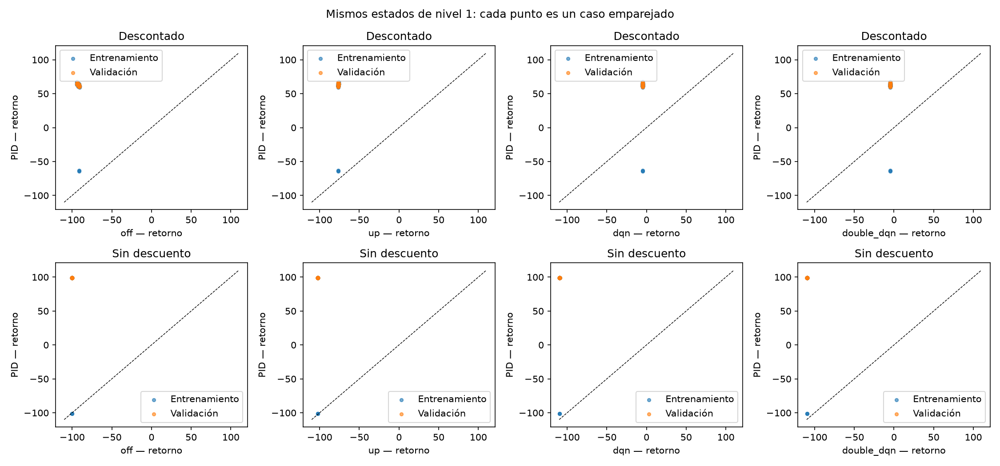
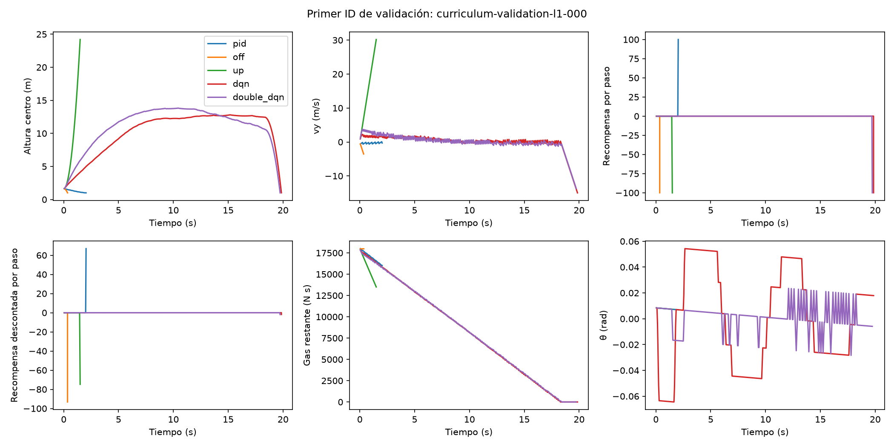

# Auditoría de recompensa v1 — nivel 1, 3 de noviembre de 2026

**Se conserva v1.** En los 157 estados donde el PID aterrizó, su retorno fue mayor
que el de cada una de las cuatro conductas fallidas desde el mismo estado, tanto
con gamma=0,99 como sin descuento: 628/628 comparaciones favorables en cada medida.
No se creó v2. Siguiendo la alternativa solicitada, quedó preparado un experimento
separado de exploración; **no se ejecutó entrenamiento nuevo**.
Esto verifica estos ejemplos; no demuestra que toda la recompensa esté bien diseñada.

## Comparación emparejada

Se ejecutaron las cinco conductas en los **128 casos de entrenamiento y 32 de
validación existentes del nivel 1**: 800 episodios. Las semillas, estados completos,
gas inicial y viento son idénticos entre conductas dentro de cada caso. No se
simularon otros niveles, los 32 originales ni la prueba final. El PID se reinició
en cada episodio. Apagado usa acción 0; empuje sostenido usa acción 7 (todos los
propulsores), incluso después de agotar gas. Las políticas finales son los
checkpoints `last.policy.pt` a 50k del currículo, en modo greedy, sin actualizaciones.
**Estos checkpoints siguen siendo agentes fallidos, no controladores funcionales.**

| Conducta | Resultado, 160 casos | G con descuento, media | Retorno sin descuento, media | Duración media (s) | Altura máxima media del centro (m) | Consumo medio (N·s) |
|---|---|---:|---:|---:|---:|---:|
| PID | 157 aterrizajes, 3 contactos inválidos | +60,381 | +95,179 | 2,279 | 2,009 | 2224,9 |
| Apagado | 160 contactos inválidos | −92,250 | −100,071 | 0,431 | 2,009 | 0 |
| Empuje sostenido | 160 salidas por techo, sin contacto | −76,519 | −102,280 | 1,492 | 24,196 | 4474,9 |
| DQN | 160 contactos inválidos | −4,563 | −109,325 | 19,856 | 12,991 | 18000 |
| Double DQN | 160 contactos inválidos | −4,524 | −109,267 | 19,691 | 13,695 | 18000 |

PID: **125/128** en entrenamiento y **32/32** en validación. Sus tres fallos son
`curriculum-train-l1-059`, `098` y `121`: |ω|=0,296/0,301/0,476 rad/s supera 0,25;
las velocidades verticales son −0,286/−0,324/−0,396 m/s. No se corrigió el PID ni
se relajaron esos límites. Los errores horizontales medios al contacto
PID/apagado/DQN/Double son 0,115/0,050/0,524/0,533 m y las vy medias
−0,292/−4,415/−15,111/−13,361 m/s. Los CSV completos conservan vx, θ, ω y el
estado completo al contacto; empuje sostenido deja esos campos ausentes.

Las medias anteriores incluyen también los fallos PID. Para comprobar el orden
se usaron diferencias **por estado inicial**, no diferencias de medias:

| Otra conducta | Comparaciones con PID exitoso | Mínimo G(PID)−G(otra) | Mínimo R(PID)−R(otra) |
|---|---:|---:|---:|
| Apagado | 157 | +149,467 | +198,867 |
| Empuje sostenido | 157 | +135,585 | +201,026 |
| DQN | 157 | +63,546 | +208,020 |
| Double DQN | 157 | +63,458 | +208,046 |

En los **tres fallos PID**, DQN/Double tienen mayor retorno descontado que PID;
apagado tiene mayor retorno sin descuento. Son comparaciones entre fallos, no
inversiones de la preferencia entre aterrizar y fallar. Incluyendo esos casos,
PID gana 634/640 comparaciones descontadas y 637/640 sin descuento. No se ocultaron.
[Todos los estados emparejados](resultados/recompensa_v1_por_estado.csv),
[diferencias y percentiles por split](resultados/recompensa_v1_diferencias.csv) y
[resumen separado entrenamiento/validación y componentes](resultados/recompensa_v1_conductas.csv).
Las diferencias individuales completas están en el archivo local
`artifacts/reward_audit_level1_v1/paired_differences.csv`.



## Fórmula exacta de v1

Para una decisión k, con estados s y s', duración física efectiva Δt, gas restante I
y ángulo envuelto en [−π,π), en unidades SI:

```
Phi(s) = -abs(x)/12 - 0.3*max(y-1, 0)/25
r_terminal = +100 si success
             -100 si body_contact, missed_platform, invalid_contact u out_of_bounds
                0 si flying o time_limit
r_progress = 2 * (Phi(s') - Phi(s))
r_speed = -0.08 * Delta_t * hypot(vx', vy')/10
r_orientation = -Delta_t * (0.3*abs(theta')/pi + 0.05*abs(omega')/3)
r_gas = -5 * (I - I')/18000
r_time = -0.2 * Delta_t
r = r_terminal + r_progress + r_speed + r_orientation + r_gas + r_time
R = sum(k=0..T-1, r_k)
G = sum(k=0..T-1, 0.99**k * r_k)
```

Los términos se calculan por **decisión a 20 Hz**, no diez veces por subpaso.
Δt es menor que 0,05 s si se localiza un contacto/salida dentro del último paso.
Gamma se aplica por decisión igual que en los agentes; no se prorratea por Δt.
El progress existente no es `gamma*Phi(s')-Phi(s)` y no pone Phi terminal a cero:
usa el estado físico de contacto/salida. **No tiene garantía de invariancia de
política por shaping basado en potencial.** V2 no existe en esta etapa; no hay una
fórmula o configuración nueva de recompensa que se haya probado.

## Señal durante las trayectorias PID exitosas

Máscaras cinemáticas no excluyentes, definidas antes del análisis: corregir
inclinación reduce |θ|; frenar aumenta vy mientras vy<0, con separación geométrica
mínima del suelo <0,5 m; aproximarse horizontalmente reduce |x|; descenso reduce
separación del suelo; aterrizaje es `success`. Son observaciones de trayectoria,
no efectos causales aislados de una acción. Un paso puede pertenecer a varias filas.

| Evento observado | Pasos | Recompensa neta media/paso | Progress medio | Gas medio | Tiempo medio |
|---|---:|---:|---:|---:|---:|
| Corrección de inclinación | 2935 | −0,023381 | +0,000294 | −0,013447 | −0,010000 |
| Frenado antes del contacto | 3560 | −0,026764 | +0,000070 | −0,016667 | −0,010000 |
| Aproximación horizontal | 2353 | −0,022777 | +0,000858 | −0,013405 | −0,010000 |
| Descenso | 6992 | −0,023439 | +0,000299 | −0,013519 | −0,010000 |
| Contacto exitoso | 157 | +99,987215 | −0,000075 | −0,007447 | −0,005174 |

Todos los pasos no terminales de esas trayectorias tienen recompensa negativa.
El éxito completo sí recibe mayor retorno: su G está entre +58,949 y +67,506;
R entre +98,784 y +99,097. No se concluye adecuación solo por el signo del bonus.
La señal positiva dominante llega al contacto y exige resolver varias decenas de
decisiones antes de verla.

Durante el frenado, usar la velocidad final en vez de la inicial mejora el término
speed solo **+0,000040/paso** en promedio. La corrección de θ no siempre mejora el
costo conjunto de orientación: puede aumentar |ω|; el cambio local medio del costo
combinado es −0,0000031/paso. En la aproximación horizontal, la parte horizontal
del progress suma +0,000283/paso; el resto corresponde a la altura. Las perturbaciones
iniciales de este nivel son pequeñas: esto no verifica inclinaciones moderadas.
Datos y definición de las máscaras: [señales PID](resultados/recompensa_v1_senales_pid.csv).

A 20 Hz, el costo temporal nominal es −0,01/paso = −0,2/s. La acción 4 consume
60 N·s/paso y cuesta −0,016667/paso = −0,3333/s; la 7 consume 150 N·s y cuesta
−0,041667/paso = −0,8333/s. No existe bonus por gastar gas. Los pesos speed y
orientation también multiplican Δt; progress y gas ya son incrementos de estado.
[Escalas, rangos y percentiles por paso](resultados/recompensa_v1_escalas.csv).

Componentes medios **sin descuento** por episodio (PID incluye sus tres fallos):

| Conducta | Terminal | Progress | Speed | Orientación | Gas | Tiempo |
|---|---:|---:|---:|---:|---:|---:|
| PID | +96,250 | +0,01317 | −0,00828 | −0,00176 | −0,61804 | −0,45579 |
| Apagado | −100 | +0,02412 | −0,00888 | −0,00022 | 0 | −0,08627 |
| Empuje sostenido | −100 | −0,55392 | −0,18350 | −0,00080 | −1,24304 | −0,29833 |
| DQN | −100 | −0,05511 | −0,22616 | −0,07242 | −5 | −3,97119 |
| Double DQN | −100 | −0,05782 | −0,20745 | −0,06318 | −5 | −3,93820 |

## Incentivos que siguen siendo problemáticos

- **Demorar un fallo:** la penalización terminal descontada media es −92,182 para
  apagado y solo −1,855/−1,920 para DQN/Double. Incluso pagando gas y tiempo,
  G≈−4,5 supera a apagar y fallar pronto. Así se explica un ordenamiento entre
  fallos favorable al ascenso/flotación y agotamiento de gas. No demuestra su causa
  exclusiva ni que subir sea mejor que aterrizar: los 157 éxitos PID los superan.
- **Descender/frenar:** el progress favorece reducir altura; reducir velocidad solo
  alivia un costo pequeño y gastar gas domina el costo denso. La frenada puede tener
  peor recompensa inmediata que seguir cayendo. El beneficio observado requiere
  alcanzar el contacto válido; el orden local no garantiza que RL lo descubra.
- **Ascender:** el término de altura penaliza subir, y los 160 empujes sostenidos
  reciben menos retorno que cada aterrizaje PID. Aun así, el descuento favorece
  retrasar la futura penalización si el agente fracasa de todas formas.
- **Terminar pronto:** sin descuento, apagado gana a los dos agentes fallidos por
  ahorrar tiempo/gas; con descuento, pierde. Ambos ordenamientos coexisten.
- **Límite temporal:** v1 no aplica −100 a `time_limit`; RL lo trata como truncamiento
  con bootstrap. Ninguna de las cinco conductas llegó al límite en estos casos.
  La posible explotación de ese borde no quedó verificada y limita la conclusión.

No se cambia la recompensa para corregir esos riesgos de forma simultánea a otro
factor. La regla solicitada para estos ejemplos se cumple para **todos los
aterrizajes de referencia observados**. Por eso se conserva v1 y se prepara la
alternativa de exploración. Esto no certifica el diseño global de la recompensa.



## Único piloto propuesto: exploración, preparado sin ejecutar

Identificador `exploration_balance_reward_v1_seed42_100k_v1`.
Desde cero, DQN y Double DQN, semilla 42, máximo **100 000 pasos por agente**,
128 estados originales de entrenamiento del nivel 1, los mismos 32 reservados de
ese nivel y validación greedy inicial y cada 10k. No se usan niveles 2/3 ni la
prueba final. LR=0,0001, beta=10, gamma=0,99, MLP 128/128, Adam, clipping,
replay, batch, warmup y frecuencias se mantienen. Epsilon conserva el descenso
1000→81000 y nunca se reinicia. Redes, optimizador y replay nacen vacíos/nuevos;
no se cargan demostraciones ni pesos anteriores.

**Único cambio propuesto en la política exploratoria:** sustituir el sorteo uniforme
de la acción aleatoria (también en warmup) por probabilidades fijas del catálogo:

| Acción | 0 | 1 | 2 | 3 | 4 | 5 | 6 | 7 |
|---|---:|---:|---:|---:|---:|---:|---:|---:|
| Probabilidad | 0,35 | 0,15 | 0,025 | 0,025 | 0,35 | 0,025 | 0,025 | 0,05 |

Derivadas del catálogo y la geometría, no de acciones PID: empuje **local** medio
990 N frente a 1500 N uniforme, cercano al peso de 981 N; probabilidad de momento
cero 90% frente a 50%, momento esperado cero y todas las acciones con probabilidad
positiva. Epsilon y la elección greedy entre ocho Q no cambian. La hipótesis es
reducir ascensos y giros aleatorios mientras se buscan contactos válidos. Cambian
juntos la media de empuje y la frecuencia de momentos: no se podrá atribuir el
resultado a uno solo de esos mecanismos. **No se ha medido una mejora de control.**

Mejor checkpoint: más éxitos en los 32 casos de nivel 1, luego menor |x| entre
éxitos y, en empate completo, primero; inicial excluido. Comparar a 50k con el
piloto anterior iguala el presupuesto; a 100k también cambia el presupuesto. Para
atribuir el resultado a exploración haría falta el control uniforme a 100k sobre
los mismos manifiestos. Tampoco se ejecutó ese control. Los reinicios usan la misma
distribución; el nuevo manifiesto plano no reproduce los sorteos extra del selector
degenerado de niveles anterior, por lo que las secuencias exactas pueden diferir.

[Protocolo](../configs/exploration_balance_v1_protocol.json),
[configuración DQN](../configs/dqn_exploration_v1.json),
[configuración Double DQN](../configs/double_dqn_exploration_v1.json),
[entrenamiento nivel 1](../configs/level1_train_scenarios.json) y
[validación nivel 1](../configs/level1_validation_scenarios.json).
El protocolo de exploración se guarda en el experimento del checkpoint y se exige
igual al reanudar; RNG, replay, redes, Adam y estado vivo del entorno se conservan.
La inferencia usa la misma red y no necesita exploración.

**Comandos preparados para una autorización posterior; no ejecutados:**

```bash
.venv/bin/python scripts/train.py --config configs/dqn_exploration_v1.json --exploration configs/exploration_balance_v1_protocol.json --train-scenarios configs/level1_train_scenarios.json --validation-scenarios configs/level1_validation_scenarios.json --output artifacts/dqn_exploration_balance_v1_100k
.venv/bin/python scripts/train.py --config configs/double_dqn_exploration_v1.json --exploration configs/exploration_balance_v1_protocol.json --train-scenarios configs/level1_train_scenarios.json --validation-scenarios configs/level1_validation_scenarios.json --output artifacts/double_dqn_exploration_balance_v1_100k
```

No hay promoción de nivel ni otra campaña automática. Guardar éxitos/fallos,
componentes, contacto, consumo/duración, Q/TD por terminalidad, gradientes,
checkpoints y distribuciones de acciones. Conservar las sondas anteriores y medir
el nuevo replay por separado cuando exista. No generar resultados hipotéticos.

## Reproducción de esta auditoría y verificaciones

```bash
# Solo rollouts de las cinco conductas, requiere los checkpoints locales históricos:
.venv/bin/python scripts/audit_reward.py --output artifacts/reward_audit_level1_repeticion
MPLCONFIGDIR=/tmp/reward-audit-mpl .venv/bin/python scripts/report_reward_audit.py --input artifacts/reward_audit_level1_repeticion --output artifacts/reward_audit_level1_repeticion/report
.venv/bin/python -m pytest -q
.venv/bin/python scripts/check_env.py
```

Los directorios deben ser nuevos. `episodes.csv` guarda condición inicial, causa,
retornos/componentes descontados y sin descuento, duración, máximo, consumo y
estado de contacto; `steps.csv` guarda ambos estados, acción, Δt y cada término.
`report/` contiene diferencias por estado, percentiles y escalas. Los archivos
completos permanecen locales y excluidos de Git. Las tablas/figuras enlazadas en
`docs/resultados/` sí se pueden publicar; su [procedencia](resultados/recompensa_v1_procedencia.json)
registra fuentes y hashes.

Pasaron **97 pruebas** y el checker Gymnasium, con los dos avisos conocidos de
límites infinitos del espacio Box. Las pruebas nuevas verifican descuento y
componentes con último paso parcial, contacto ausente, penalización terminal
única, exclusión de prueba final, muestreo/soporte de acciones, inferencia sin
consumir RNG, reanudación del RNG y parámetros/manifiestos del piloto preparado.
Se verificó igualdad de estados iniciales entre conductas, suma de componentes,
recomputación de cada recompensa y pesos/RNG inalterados en inferencia. Los
experimentos, física, criterios, gas y PID previos se preservaron por hash; el
entrenador anterior se archivó antes de añadir la opción explícita de exploración.
Las pruebas unitarias de la suite no constituyen la ejecución de ese piloto.
