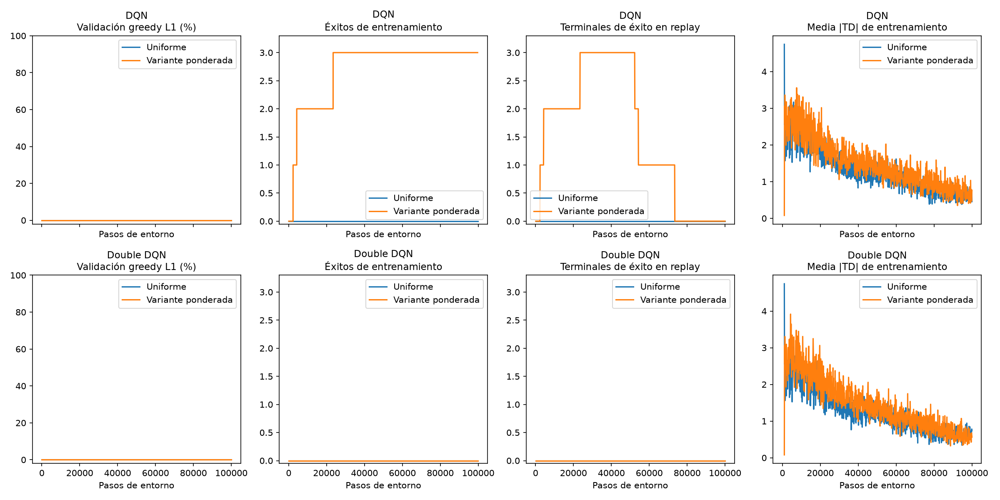
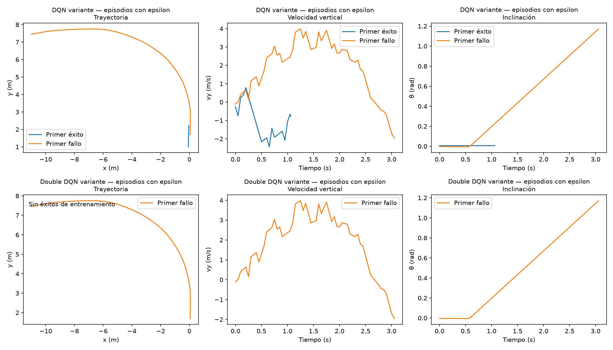

# Exploración uniforme frente a una variante ponderada — semilla 42

**Ejecutado: cuatro entrenamientos de 100 000 pasos desde cero.** Solo DQN con
la variante ponderada encontró aterrizajes durante entrenamiento: tres. Ninguna
de las cuatro políticas consiguió aterrizajes greedy en ninguna evaluación.
Se conservaron recompensa v1, física, acciones, gas, umbrales y PID. No se ejecutó
la prueba final, otra modificación ni una campaña de varias semillas.

Experimento `exploration_comparison_level1_seed42_100k_v1`.
La exploración ponderada es una **variante de DQN/Double DQN**, no DQN estándar.
Las cifras siguientes corresponden a esta ejecución; el protocolo anterior con
estado `prepared_not_run` se conserva como documento histórico de preparación.

## Método verificado antes de entrenar

Probabilidades **condicionadas a que la decisión sea exploratoria**:

| Acción | Activación | Uniforme original | Variante |
|---|---|---:|---:|
| 0 | Apagado | 0,125 | 0,350 |
| 1 | Central | 0,125 | 0,150 |
| 2 | Izquierdo | 0,125 | 0,025 |
| 3 | Derecho | 0,125 | 0,025 |
| 4 | Ambos laterales | 0,125 | 0,350 |
| 5 | Central + izquierdo | 0,125 | 0,025 |
| 6 | Central + derecho | 0,125 | 0,025 |
| 7 | Todos | 0,125 | 0,050 |

Para t, contador de interacciones **antes** de decidir:

```
epsilon(t) = 1 - 0.9 * clip((t - 1000)/80000, 0, 1)
t < 1000: a ~ Categorical(p), sin puerta Bernoulli adicional
resto: pi(a|s,t) = epsilon(t)*p[a] + (1-epsilon(t))*1[a=argmax Q(s,.)]
evaluacion: a = argmax Q(s,.)
```

Epsilon alcanza 0,1 a 81k, sin reiniciarse. Durante exploración, p es constante,
independiente de observación, acciones anteriores, resultados o fase del episodio;
se sortea de nuevo en **cada decisión de 0,05 s**. La parte greedy sí depende del
estado. No hay repetición forzada, bloques de acciones ni fase persistente nueva.
Repetir una acción puede ocurrir por azar: entre dos sorteos exploratorios, la
probabilidad teórica de coincidencia es 0,125 frente a 0,2725 por la concentración
de p; eso no introduce memoria.

Todas las probabilidades exploratorias son positivas. Con epsilon mínimo 0,1,
cualquier acción tiene probabilidad marginal al menos 0,0125 uniforme o 0,0025
en la variante. Esta condición no se aplica a evaluación greedy, que deliberadamente
elimina la exploración. No se modifican las restricciones físicas al agotarse el gas.

La lista se deriva del catálogo: empuje **local** esperado 990 N frente a 1500 N,
peso 981 N y 90% de acciones sin momento frente a 50%; momento esperado cero.
La inclinación y el gas determinan la fuerza realmente producida en el simulador.
El código de selección solo consulta esos p y la puerta epsilon: no utiliza acciones
PID, demostraciones, información futura, recompensa futura ni datos de prueba.
Los pesos iniciales no se cargan de ningún agente anterior.

No se añadió estado al controlador ni entrada a la red. Continúan las nueve
observaciones físicas normalizadas y el replay de transiciones existente. El
contador epsilon y los RNG se guardan como antes. `last_selection_mode` es una
etiqueta de telemetría de la decisión ya tomada: no se consulta para decidir la
siguiente acción ni entra en el replay o en la red. Las etiquetas registran la
puerta **real**, incluso cuando la acción aleatoria coincide con argmax. Se comprobó
numéricamente que instrumentar el control uniforme conserva acciones y RNG.

## Comparación con igual presupuesto

Se optó por **reiniciar también los controles uniformes**, sin extender los
checkpoints del currículo. Así ambos métodos utilizan el mismo selector plano
de los 128 estados existentes del nivel 1, uniformemente con RNG inicial 142,
y el mismo presupuesto de 100k. La distribución es la del nivel 1 anterior, aunque
el selector antiguo consumía además un sorteo degenerado de nivel; por eso no se
trata este control nuevo como una continuación exacta del anterior. Los archivos
antiguos permanecen intactos y no se gastaron sus 50k pasos como parte de esta ejecución.

Cada algoritmo y método comienza con semilla 42, redes iniciales idénticas,
Adam nuevo y replay vacío. LR=0,0001, `SmoothL1Loss(beta=10)` sin compensación,
gamma=0,99, MLP 128/128 ReLU, clip de norma 10, replay 50k, batch 64, warmup 1000,
aprendizaje cada 4 pasos y copia objetivo cada 500 desde warmup. Solo cambia el
sorteo de acciones exploratorias entre los dos métodos de esta comparación.
El RNG de acciones/epsilon se mantiene como en el código previo; `integers` y
`choice(p)` consumen RNG de manera diferente entre métodos. Dentro de cada método,
ambos algoritmos recibieron exactamente la misma secuencia de decisiones exploratorias
y acciones aleatorias; el resto de su trayectoria puede diferir por las elecciones greedy.

Validación inicial y cada 10k: los **128 casos existentes**, 32 por nivel 1/2/3
más 32 originales, sin explorar ni actualizar pesos. Solo el nivel 1 aporta
transiciones de entrenamiento. La prueba final no se simuló; el manifiesto de
prueba se utiliza por la infraestructura existente únicamente para excluir
identidades. El mejor checkpoint se escoge por éxito en L1, luego menor |x|
entre aterrizajes y, si empata, el primero; inicial excluido. Todos quedaron
en 10k por empate sin éxitos. Los resultados finales usan `last`, a 100k.

## Resultados y retención

| Algoritmo / método | Episodios completos | Éxitos entrenando con epsilon | Primer éxito | Éxitos greedy L1 finales | Éxitos greedy, todos los casos | Terminales exitosos en replay final |
|---|---:|---:|---:|---:|---:|---:|
| DQN uniforme | 911 | 0 | — | 0/32 | 0/128 | 0 |
| DQN, variante ponderada | 1058 | 3 | 2324 | 0/32 | 0/128 | 0 |
| Double DQN uniforme | 885 | 0 | — | 0/32 | 0/128 | 0 |
| Double DQN, variante ponderada | 997 | 0 | — | 0/32 | 0/128 | 0 |

No hubo éxitos greedy en **ningún punto**, tampoco en otros niveles. Las 5632
evaluaciones de episodios incluyen repeticiones de 128 casos fijos en once puntos
de cuatro ejecuciones; no son 5632 estados independientes. Al terminar quedaron
episodios vivos de 48/295/240/83 pasos en el orden de la tabla. No se contaron como
terminados ni se convirtió el corte presupuestario en contacto/terminal artificial.

Los tres éxitos DQN de la variante:

| Paso de entorno | Caso de entrenamiento | Decisiones exploratorias / greedy | Acción terminal tomada en modo | Duración (s) | Impulso (N·s) | vy contacto (m/s) | |x| contacto (m) |
|---|---|---:|---|---:|---:|---:|---:|
| 2324 | l1-109 | 22 / 0 | Exploración | 1,061 | 990,0 | −0,770 | 0,0777 |
| 4257 | l1-082 | 13 / 0 | Exploración | 0,619 | 593,3 | −0,367 | 0,0804 |
| 23468 | l1-111 | 18 / 3 | Exploración | 1,044 | 1008,7 | −0,407 | 0,00004 |

Prefijo de IDs: `curriculum-train-`. Son éxitos físicos con los umbrales originales,
no etiquetas PID ni estados inicialmente en contacto. Los dos primeros fueron
episodios enteramente exploratorios; el tercero fue mixto. Esto prueba encontrar
trayectorias exitosas con el comportamiento exploratorio, **no aprender a
reproducirlas sin exploración**.

La cuenta de transiciones **terminales** de éxito retenidas en el replay de la
variante DQN a 10k/20k/30k/40k/50k/60k/70k/80k/90k/100k fue
**2/2/3/3/3/1/1/0/0/0**. Todas las otras ejecuciones permanecieron en cero.
El replay circular las expulsó al sobrepasar su ventana de 50k. Esto limita la
exposición posterior a recompensas de éxito; no prueba por sí solo que la expulsión
sea la causa del fallo de aprendizaje. No se cambió muestreo ni se reinsertaron éxitos.
[Comparación a los mismos pasos](resultados/exploracion_presupuesto_igual.csv).



## Frecuencias observadas y fallos

Hubo 46 764 decisiones exploratorias y 53 236 de explotación por control uniforme;
46 875 y 53 125 por variante. Las frecuencias exploratorias son idénticas entre
DQN y Double DQN dentro de cada método, coherentemente con sus RNG y calendarios:

| Acción | Uniforme observado | Variante observada |
|---|---:|---:|
| 0 | 12,311% | 34,914% |
| 1 | 12,642% | 14,950% |
| 2 | 12,510% | 2,530% |
| 3 | 12,326% | 2,541% |
| 4 | 12,644% | 34,886% |
| 5 | 12,790% | 2,596% |
| 6 | 12,411% | 2,519% |
| 7 | 12,366% | 5,062% |

[Frecuencias de entrenamiento por exploración y explotación](resultados/exploracion_acciones.csv).
El archivo local `report/action_frequencies.csv` añade la evaluación greedy por
conjunto y checkpoint; `decisions.csv` conserva cada acción, modo y epsilon utilizado.
Los conteos incluyen decisiones con gas cero: son acciones solicitadas, aunque el
simulador ya no produzca empuje. No se confundió explotación de entrenamiento con
evaluación greedy independiente.

| Algoritmo / método | Contactos entrenando | Salida lateral / techo | Cuerpo / fuera de plataforma / contacto inválido | Episodios con gas agotado |
|---|---:|---|---|---:|
| DQN uniforme | 166 | 376 / 369 | 95 / 47 / 24 | 62 |
| DQN variante | 258 | 295 / 505 | 88 / 45 / 122 | 29 |
| Double DQN uniforme | 156 | 391 / 338 | 84 / 29 / 43 | 60 |
| Double DQN variante | 268 | 290 / 439 | 98 / 37 / 133 | 31 |

Los contactos DQN variante incluyen sus tres éxitos además de los fallos listados.
No hubo truncamientos temporales entre episodios completos en esta ejecución.
Datos finales greedy de L1, con métricas de contacto solo donde existe:

| Método | Resultado en 32 casos | Duración media (s) | Consumo medio (N·s) | vy contacto | |x| contacto | |θ| contacto |
|---|---|---:|---:|---:|---:|---:|
| DQN uniforme | 32 techo, sin contacto | 16,747 | 16601,2 | — | — | — |
| DQN variante | 26 fuera de plataforma, 6 inválidos | 20,310 | 18000 | −19,526 | 4,497 | 0,0289 |
| Double DQN uniforme | 32 techo, sin contacto | 14,049 | 14043,7 | — | — | — |
| Double DQN variante | 12 fuera de plataforma, 20 inválidos | 20,374 | 18000 | −20,103 | 1,671 | 0,0398 |

vx medio al contacto en las variantes: +0,629/+0,290 m/s; |ω| medio
0,00214/0,00214 rad/s. Las velocidades verticales incumplen el límite −1 m/s
en los 64 contactos de ambas variantes. En los otros tres conjuntos también
hubo 32 salidas por techo por control y 32 contactos con gas agotado por variante,
siempre sin éxitos. No se presentan estados de salida como métricas de aterrizaje.
[Métricas de contacto](resultados/exploracion_contactos.csv) y
[causas, duración, consumo, retornos y componentes por resultado](resultados/exploracion_resultados_por_causa.csv).

En entrenamiento, retorno no descontado/descontado medio:
DQN uniforme −104,591/−49,718; variante −103,415/−48,671;
Double uniforme −104,643/−48,273; variante −104,076/−48,232.
Los cambios de retorno entre fallos no equivalen a progreso de aterrizaje.
Se muestran el primer éxito y primer fallo de entrenamiento cuando existen;
para validación se usa el primer ID de L1 y del conjunto original, sin escoger
el mejor episodio. Se conservan todas las trayectorias reservadas por checkpoint.



## Q, TD y gradientes

Se conservó la sonda fija anterior A (64 terminales/64 no terminales) y el holdout
terminal D, con las mismas identidades en cada checkpoint. Los replays **nuevos** C
se analizaron con 128 minibatches uniformes de 64 cada uno; cada modelo se midió
sobre ambos replays de su algoritmo. Se guardaron índices, hashes, medias y
percentiles firmados de Q, recompensa, target, TD=target−Q, bootstrap y error Q−r.
No hubo actualizaciones de optimizador durante ese diagnóstico. En terminales,
el target es exactamente la recompensa; los truncamientos conservan bootstrap.

También se congelaron, como sonda E, las dos transiciones terminales exitosas del
primer checkpoint que las contiene (DQN variante, 10k). Se midieron sobre ambos
modelos DQN y todos sus checkpoints. Son datos de entrenamiento seleccionados
posteriormente para diagnóstico, no una validación independiente ni demostraciones.
En la variante a 100k su Q(s,a) medio era +11,515 frente a target +99,994: TD +88,479.
Estos ejemplos se encontraron, pero no se ajustaron cerca de su recompensa terminal.
No se dedujo su contribución al gradiente únicamente de ese residuo.

En A, MAE terminal final DQN uniforme/variante=44,73/51,53 y Double=52,42/59,74.
La sonda procede de una distribución anterior, no estima el error poblacional de L1.
En minibatches de cada replay nuevo, las proporciones terminales fueron
25/8192, 44/8192, 28/8192 y 37/8192 en el orden habitual. Normas medias de la
contribución ponderada T/N al gradiente compartido: 0,130/0,542;
0,227/0,295; 0,145/0,470; 0,180/0,235. Cosenos medios cuando ambas normas son
no nulas: −0,155; +0,294; −0,333; −0,206. Se verificó g=pT·gT+pN·gN.
Los nuevos replays finales no contienen éxitos y esas estadísticas describen
terminales fallidos; no se mezclan con A ni E.

Q inicial greedy / G observado y **brecha frente al retorno de la política greedy**
en los 32 casos L1 finales:

| Método | Q inicial medio | G observado | Brecha |
|---|---:|---:|---:|
| DQN uniforme | +15,058 | −6,167 | +21,224 |
| DQN variante | +13,435 | −4,675 | +18,110 |
| Double DQN uniforme | +14,471 | −8,758 | +23,230 |
| Double DQN variante | +8,589 | −4,391 | +12,980 |

Es una comparación con retorno greedy, no error exacto frente a Q óptimo. Q más
pequeño, menor brecha o menos |TD| no prueban mejor control. Las métricas numéricas
son finitas desde el inicio de aprendizaje; las normas medias por intervalo
máximas antes/después de clipping son iguales (1,455/1,143/1,409/1,139).
No se observó clipping activo en esas medias. El resultado de control sigue en cero.
[Q/TD firmados y percentiles](resultados/exploracion_q_td.csv) y
[gradientes ponderados por grupo](resultados/exploracion_gradientes.csv).

**Conclusión:** con la variante se observaron tres descubrimientos exploratorios en esta
realización DQN, sin aprendizaje greedy demostrado; Double DQN no encontró éxitos
con ninguno de los dos métodos. No hay evidencia de retención de una habilidad
ni de transferencia a niveles superiores. Una sola semilla no permite afirmar
superioridad general de la variante o de un algoritmo. No se encadenó otra ablación.

## Artefactos, verificaciones y comandos

Ruta local: `artifacts/exploration_comparison_level1_seed42_100k_v1/`.
Los checkpoints no son controladores de aterrizaje funcionales.
Cada carpeta `dqn_uniform`, `dqn_weighted_variant`, `double_dqn_uniform` y
`double_dqn_weighted_variant` contiene checkpoints de política y reanudación
cada 10k, `best`, `last`, CSV por episodio, actualizaciones, decisiones y validación
con trazas. `last.resume.pt` conserva redes, Adam, replay, RNG, estado físico vivo,
selector de escenarios y contadores de telemetría; la inferencia es greedy y no
requiere activar la variante exploratoria. `report/` incluye comparación a cada
presupuesto, estados de contacto, frecuencias, éxitos individuales, Q/retorno y tiempos;
`diagnostics/` contiene las sondas y gradientes firmados.

Las tablas/figuras enlazadas en `docs/resultados/` son la selección publicable;
los checkpoints, CSV completos y trazas quedan locales excluidos de Git.
La [procedencia](resultados/exploracion_procedencia.json) registra hashes.
`configs/exploration_comparison_execution.json` fija este protocolo y
`execution_manifest.json` registra las fuentes efectivamente ejecutadas.
Las fuentes previas a la instrumentación se archivaron en
`artifacts/exploration_comparison_reference/`. Las referencias anteriores,
la física, recompensa y PID se verificaron por hash; no se sobrescribieron experimentos.

Tiempo medido por ejecución, incluyendo validación y guardado:
DQN uniforme 177,20 s; variante 122,55 s; Double uniforme 156,05 s;
variante 131,48 s. Total **587,28 s**, con 400 000 interacciones de entrenamiento,
24 751 actualizaciones y 199 copias objetivo por ejecución. El análisis y las pruebas
no están incluidos en ese tiempo. No se estimó ni inició una campaña completa.

Reproducción desde cero, en una salida nueva; ejecuta **solo las cuatro corridas**:

```bash
.venv/bin/python -m pytest -q
.venv/bin/python scripts/check_env.py
.venv/bin/python scripts/run_exploration_comparison.py --output artifacts/exploration_comparison_repeticion
.venv/bin/python scripts/diagnose_exploration_comparison.py --root artifacts/exploration_comparison_repeticion
MPLCONFIGDIR=/tmp/exploration-comparison-mpl .venv/bin/python scripts/report_exploration_comparison.py --root artifacts/exploration_comparison_repeticion
```

Ejecutar solo una variante o su control uniforme (omitir `--exploration` para
el control; cambiar el JSON y salida para Double DQN):

```bash
.venv/bin/python scripts/train.py --config configs/dqn_exploration_v1.json --exploration configs/exploration_balance_v1_protocol.json --run-protocol configs/exploration_comparison_execution.json --train-scenarios configs/level1_train_scenarios.json --validation-scenarios configs/curriculum_validation_scenarios.json --output artifacts/dqn_variante_repeticion
```

Evaluar/reproducir un checkpoint final; añadir `--render` abre la ventana local:

```bash
.venv/bin/python scripts/evaluate.py --checkpoint artifacts/exploration_comparison_level1_seed42_100k_v1/dqn_weighted_variant/last.policy.pt --scenarios configs/curriculum_validation_scenarios.json --trace --output artifacts/exploracion_reproduccion.csv
```

No se comprobó teclado real. Para continuar una ejecución propia interrumpida,
usar su `.resume.pt`, la misma configuración/protocolos y una salida nueva con
`--resume`; el presupuesto es total, nunca pasos adicionales. No se debe promover
al nivel 2 ni modificar el protocolo de un checkpoint de currículo para fingir
una reanudación exacta. En una reanudación, `decisions.csv` registra el segmento
nuevo y los contadores del runner conservan el acumulado anterior.

Pasaron **100 pruebas** y el checker Gymnasium, con los dos avisos conocidos de Box
con límites infinitos. Las verificaciones incluyen acciones/RNG idénticos al cuerpo
uniforme previo, etiquetas correctas cuando exploración coincide con argmax,
inferencia sin consumir RNG y reanudación de un episodio vivo con pesos, replay
y conteos de modos idénticos a una ejecución continua. Los histogramas suman 100k
por corrida, los éxitos retenidos coinciden con los terminales de éxito de la ventana
final y todas las transiciones de replay proceden de L1.
