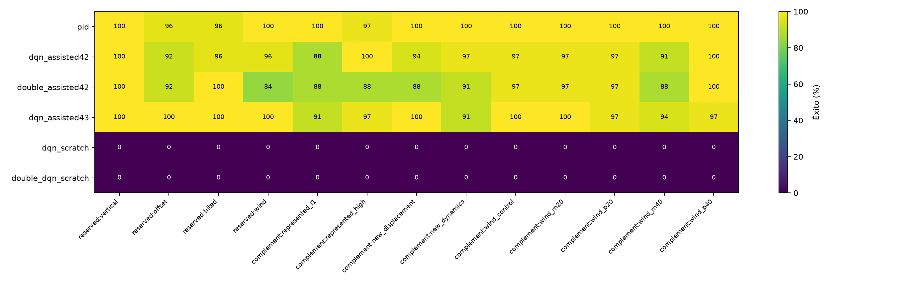
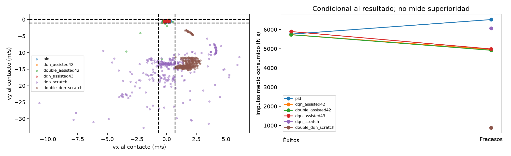

# Control de aterrizaje de un vehículo 2D con PID, DQN y Double DQN

**Informe técnico, matemático y experimental de la versión entregable — 4 de noviembre de 2026.**

Estado: modelos y evaluación final congelados. Este cierre amplía la documentación y verifica archivos existentes; no incorpora entrenamientos ni reajustes posteriores a la prueba. La propuesta original permanece como contrato de alcance. Las demostraciones PID se incorporaron como una **ampliación metodológica adicional** para estudiar políticas asistidas, conservando por separado los baselines desde cero.

## 1. Resumen

Se construyó un simulador físico propio de cuerpo rígido plano, con propulsor principal, dos propulsores laterales binarios, gravedad, viento horizontal y presupuesto limitado de impulso. Se implementaron PID en cascada y agentes DQN/Double DQN con replay y red objetivo. Los experimentos desde cero no produjeron aterrizajes greedy funcionales con los checkpoints finalmente evaluados. Una variante asistida, que combina imitación de trayectorias PID y aprendizaje por diferencia temporal (TD), sí produjo políticas neuronales capaces de aterrizar sin consultar al PID durante inferencia.

La evaluación común conservó 100 escenarios reservados y añadió 288 casos complementarios independientes. PID obtuvo **98/100 y 287/288**; DQN asistido, **96/100 y 275/288**; Double DQN asistido, **94/100 y 266/288**. Ambos baselines desde cero obtuvieron cero éxitos en ambos conjuntos. La semilla adicional DQN asistida obtuvo 100/100 y 277/288, sin reemplazar después de la prueba a la candidata principal.

PID fue la solución más consistente entre los métodos principales en esta ejecución. El entrenamiento asistido ofrece una política aprendida funcional en los casos medidos, pero no demuestra superioridad general, adaptación automática ni beneficio causal de TD. **No se aisló el beneficio de las actualizaciones TD frente a la imitación por sí sola**.

## 2. Problema, justificación y pregunta de investigación

El problema consiste en llevar un vehículo inicialmente en vuelo hasta una plataforma fija, limitando desplazamiento, velocidad de impacto, inclinación, giro y consumo. Actuar sobre el empuje modifica simultáneamente traslación, rotación y recursos disponibles; el catálogo discreto exige secuencias de activación precisas, especialmente antes del contacto.

La inspiración conceptual es el Tesla Roadster como vehículo con propulsores. La masa, geometría, fuerzas y dinámica son **académicas propias**, sin equivalencia exacta con un vehículo Tesla ni validación de tecnología comercial. No se modela un automóvil real ni se afirma afiliación con Tesla.

La pregunta original es: **¿cómo se comparan DQN y Double DQN con un PID en consistencia, precisión y consumo, bajo condiciones iniciales y viento comunes?** La investigación requiere conservar también resultados negativos: una menor loss o un valor Q más pequeño no implica aterrizaje, y terminar antes en impacto no significa mayor eficiencia.

## 3. Objetivos y alcance

El objetivo general es desarrollar y evaluar controladores de estabilización y aterrizaje con recursos limitados. Los objetivos específicos materializados son: construir el simulador verificable; formular observaciones, acciones y recompensa; implementar PID/DQN/Double DQN; registrar episodios reproducibles; comparar métodos sobre casos comunes; visualizar y documentar resultados y límites.

El alcance es 2D: un solo cuerpo rígido, plataforma fija, gravedad uniforme, propulsores discretos, viento horizontal constante durante el episodio, gas abstracto, ejecución sin gráficos y animación. Se excluyen 3D, hardware, aerodinámica detallada, navegación, plataformas móviles, múltiples vehículos y validación real. La [matriz de trazabilidad](trazabilidad_alcance.md) distingue cumplimiento técnico, evidencia y pendientes.

La asistencia se añadió al constatar el fracaso de las políticas desde cero. Se mantienen ambas familias identificadas; no se reetiquetan los resultados asistidos como aprendizaje autónomo desde cero.

## 4. Fundamentos matemáticos y diseño del simulador

### 4.1 Estado, unidades y variables observables

Se usan coordenadas globales (x) hacia la derecha y (y) hacia arriba, con plataforma centrada en (x=0), suelo (y=0), ángulo θ positivo antihorario y θ=0 vertical. El estado físico es

$$
s=(x,y,v_x,v_y,\theta,\omega,G),\qquad W=\text{fuerza horizontal de viento}.
$$

Posición en m, velocidades en m/s, θ en rad, ω en rad/s, (G) en N·s, (W) en N. El simulador mantiene además reloj, estado de finalización y RNG, que no son entradas adicionales de la red.

La observación float32 realmente utilizada es

$$
o=\left[\frac{x}{12},\frac{y-1}{25},\frac{v_x}{10},\frac{v_y}{10},
\sin\theta,\cos\theta,\frac{\omega}{3},\frac{G}{18000},\frac{W}{100}\right].
$$

La red asistida recibe una transformación fija de esas mismas nueve variables:

$$
f(o)=\left[\frac{x}{1.5},\frac{y-1}{2},\frac{v_x}{0.7},\frac{v_y}{1},
\frac{\sin\theta}{0.12},\cos\theta,\frac{\omega}{0.25},\frac{G}{18000},\frac{W}{100}\right].
$$

No se recortan valores a [-1,1]; las escalas no son límites físicos. La transformación es invertible respecto al vector original, salvo redondeo float32, y no añade información. Posición, velocidades, ángulo, giro, gas y viento son ideales, sin ruido sensorial. La red no recibe acciones PID, integrales del profesor, recompensa futura, geometría futura ni tiempo restante. En la evaluación común PID recibe el mismo Box decodificado a SI, incluido θ=atan2(sinθ,cosθ); sus integrales son memoria propia del controlador.

Código: [`landing._observation`](../src/thruster_landing/envs/landing.py), [`landing_features`](../src/thruster_landing/recovery_agent.py), [`decode_observation`](../src/thruster_landing/scope_evaluation.py).

### 4.2 Geometría, fuerzas y momentos

Parámetros de [`env.json`](../configs/env.json): masa (m=100\,\mathrm{kg}), ancho (b=1.4\,\mathrm m), altura (h=1.6\,\mathrm m), gravedad (g=9.81\,\mathrm{m/s^2}). La inercia de rectángulo uniforme es

$$I=\frac{m(b^2+h^2)}{12}=37.6666667\,\mathrm{kg\,m^2}.$$

Los apoyos locales son (-0.6,-1) y (0.6,-1) m; las esquinas del cuerpo, (±0.7,±0.8) m. El centro en reposo vertical está a (y=1) m. Cada punto local (p_i^B) se transforma mediante

$$p_i=\begin{bmatrix}x\\y\end{bmatrix}+R(\theta)p_i^B,
\qquad R(\theta)=\begin{bmatrix}\cos\theta&-\sin\theta\\\sin\theta&\cos\theta\end{bmatrix}.$$

Las posiciones de los propulsores respecto al centro son (r_M=(0,-0.8)), (r_L=(-0.6,-0.8)), (r_R=(0.6,-0.8)) m. Sus fuerzas locales son (F_M^B=(0,1800)), (F_L^B=F_R^B=(0,600)) N. Son laterales por ubicación: **no generan directamente empuje horizontal local**; el desplazamiento horizontal procede de inclinar el vehículo.

Para activaciones (u_i\in\{0,1\}),

$$F_T=R(\theta)\sum_i u_i F_i^B,\qquad
\tau=\sum_i u_i(r_{i,x}F_{i,y}^B-r_{i,y}F_{i,x}^B).$$

Los momentos son 0, -360 y +360 N·m respectivamente. Las aceleraciones son

$$\dot v=\frac{F_T+(W,-mg)}m,\qquad \dot\omega=\frac\tau I,\qquad
\dot x=v_x,\ \dot y=v_y,\ \dot\theta=\omega.$$

Para θ>0, (F_{T,x}=-F_T^B\sin\theta<0): inclinar a la izquierda produce aceleración hacia la izquierda. El viento se aplica al centro de masa, sin momento. Se fija al reset o se sortea uniforme alrededor de media/amplitud configuradas, y permanece constante todo el episodio.

### 4.3 Catálogo, integración y consumo

| Acción | Principal/izquierdo/derecho | Empuje local N | Momento N·m |
|---:|---|---:|---:|
| 0 | 000 | 0 | 0 |
| 1 | 100 | 1800 | 0 |
| 2 | 010 | 600 | -360 |
| 3 | 001 | 600 | +360 |
| 4 | 011 | 1200 | 0 |
| 5 | 110 | 2400 | -360 |
| 6 | 101 | 2400 | +360 |
| 7 | 111 | 3000 | 0 |

Una decisión dura Δt=0.05 s (20 Hz), con diez subpasos de δt=0.005 s. La fuerza global se recalcula al principio del subpaso y se mantiene congelada dentro de él:

$$p^+=p+v\delta t+\tfrac12 a\delta t^2,\quad v^+=v+a\delta t,$$
$$\theta^+=\theta+\omega\delta t+\tfrac12\alpha\delta t^2,\quad
\omega^+=\omega+\alpha\delta t.$$

Después se lleva θ a [-π,π). No es RK4 ni un integrador exacto cuando cambia la orientación durante el subpaso. La auditoría RK4 independiente es una referencia de verificación, no la implementación del entorno.

La tasa de consumo es (q(a)=\sum_i u_i\|F_i^B\|), en N. El presupuesto disminuye en (q\delta t), en N·s. Si no alcanza, se integra empuje durante (\delta t_b=\min(\delta t,G/q)) y luego caída libre durante el resto; para q=0 no hay combustión. Se corta consumo en el instante de contacto localizado. El gasto es impulso escalar sumado, sin cancelar fuerzas ni momentos: **18000 N·s no son 18000 kg de gas**. No se modelan presión, caudal o velocidad de escape; masa e inercia permanecen constantes aunque disminuya G. Es una aproximación, no una conservación física de masa de combustible.

La autoridad vertical máxima es (3000/100-9.81=20.19\,\mathrm{m/s^2}). Un pulso lateral completo cambia ω en (360(0.05)/I=0.477876\,\mathrm{rad/s}), superior al umbral de contacto0.25: se requieren pulsos compensatorios o cortados por contacto. Esta cuantización ayuda a interpretar fallos angulares; no prueba que el catálogo impida aterrizar.

Código: [`physics.py`](../src/thruster_landing/envs/physics.py), `wrench`, `geometry`, `_segment`, `integrate`.

### 4.4 Contacto, éxito y terminación

El primer punto geométrico que cruza (y\le0) termina el episodio. El cruce se detecta en extremos de subpasos y se localiza con 35 bisecciones. No se simula rebote, fricción ni asentamiento posterior. Sea (p_{L/R}) cada apoyo y (p_{B,j}) las esquinas. El éxito requiere simultáneamente:

$$\min_j p_{B,j,y}>10^{-6},\quad |p_{L,x}|,|p_{R,x}|\le2.5,
\quad \max(p_{L,y},p_{R,y})\le0.15,$$
$$|x|\le1.5,\quad |v_x|\le0.7,\quad -1\le v_y\le0,
\quad |\theta|\le0.12,\quad |\omega|\le0.25.$$

Las unidades son m, m/s, rad y rad/s según variable. Primero se distingue contacto de cuerpo, después apoyo fuera de plataforma y finalmente incumplimiento cinemático. Cualquier punto que salga de ∣x∣<12 m o supere y<25 m causa salida del área. Éxito, contacto inválido, cuerpo, plataforma fallida y salida son `terminated`. A25 s, sin evento físico, `time_limit` es `truncated`. Gas cero no termina por sí solo. Un contacto coincidente con el límite tiene prioridad física.

La bisección no es un detector continuo garantizado para rotaciones extremas que cruzan y regresan dentro del subpaso. El informe no presenta esa limitación como resuelta. Código: `landing._boundary`, `_contact_outcome`, `step`.

## 5. PID en cascada

La función concreta de [`PIDLoop.update`](../src/thruster_landing/agents/pid.py) usa derivada de la **medición**, no diferencia del error de consigna. Con error (e_k=r_k-z_k), contribución integral (J_k), aporte externo f y límites L/U:

$$\widetilde J=\operatorname{clip}(J_{k-1}+k_i e_k\Delta t,-J_{max},J_{max}),
\qquad b=f+k_p e_k-k_d\dot z_k.$$

Se conserva (J_k=J_{k-1}) si (b+\widetilde J>U\land e_k>0), o (b+\widetilde J<L\land e_k<0); en otro caso (J_k=\widetilde J). La salida es (\operatorname{clip}(b+J_k,L,U)). Es integración condicional con cota, no back-calculation ni garantía de estabilidad después de asignar acciones. Los fundamentos P/I/D y saturación se contextualizan en [Åström y Murray](https://www.cds.caltech.edu/~murray/books/AM08/pdf/fbs-author_29Mar19.pdf); las ecuaciones anteriores describen específicamente el código propio.

Las integrales están en unidades de salida: aceleración lineal en lazos de velocidad y angular en orientación. (J_{max}=5) en cada lazo. Se reinician por episodio; con gas agotado el controlador reinicia y devuelve apagado. La aceleración estimada es diferencia de velocidades/Δt, cero en la primera decisión. Las derivadas horizontal y vertical configuradas son **cero**; en orientación se usa la ω medida con (k_d=16\,\mathrm{s^{-1}}), sin filtro derivativo adicional.

Las ganancias concretas también fijan unidades: en horizontal/vertical el error es m/s y la salida m/s²; en orientación son rad y rad/s². La derivada es de la medición correspondiente.

| Lazo | kp | ki | kd |
|---|---|---|---|
| Velocidad horizontal | 1.5 s⁻¹ | 0.05 s⁻² | 0, adimensional |
| Velocidad vertical | 4 s⁻¹ | 2 s⁻² | 0, adimensional |
| Orientación | 80 s⁻² | 0 s⁻³ | 16 s⁻¹ |

### 5.1 Cascada horizontal y orientación

$$v_x^*=\operatorname{clip}(-0.5x,-1,1)\ \mathrm{m/s},$$
$$a_x^*=\operatorname{PID}_{(1.5,0.05,0)}(v_x^*-v_x,\dot v_x;[-2,2]).$$

La fuerza solicitada es (F_x^*=m a_x^*-W). La compensación usa viento observable, no una estimación futura. Después de obtener (F_y^*) del lazo vertical:

$$H=\max(0,y-1),\quad
\theta_{lim}=0.04+(0.2-0.04)\min(1,H/3),$$
$$\theta^*=\operatorname{clip}\left[-\operatorname{atan2}(F_x^*,\max(F_y^*,0.1)),
-\theta_{lim},\theta_{lim}\right].$$

El error angular se envuelve a [-π,π). Se solicita

$$\alpha^*=\operatorname{PID}_{(80,0,16)}(\operatorname{wrap}(\theta^*-\theta),\omega;
[-360/I,360/I]),\qquad \tau^*=I\alpha^*.$$

Así, para desplazar a la derecha se solicita inclinación negativa. Cerca del suelo se reduce la inclinación permitida, priorizando contacto nivelado.

### 5.2 Descenso y gravedad

$$v_y^*=-\min\left(2,\sqrt{0.4^2+2(0.8)H}\right)\ \mathrm{m/s},$$
$$a_y^*=\operatorname{PID}_{(4,2,0)}\left(v_y^*-v_y,\dot v_y;
[-g,3000\max(0,\cos\theta)/m-g]\right),$$
$$F_y^*=m(g+a_y^*).$$

La expresión de velocidad combina descenso rápido lejos del suelo y frenado cerca del contacto. El término (mg) compensa gravedad **fuera de** `PIDLoop.update`; no hay un término adicional de feedforward no declarado en esos lazos. Las ganancias y límites provienen de [`pid.json`](../configs/pid.json), no de un reajuste con prueba final.

### 5.3 Asignación discreta

Para cada acción se calcula su fuerza global (F_a), momento τ_a y tasa q_a a la orientación actual. Su fracción útil durante una decisión es (\lambda_a=\min(1,G/(q_a\Delta t))), o1 si q_a=0. Se elige el menor índice en empate que minimiza

$$a^*=\arg\min_a\left[
0.5\left(\frac{\lambda_a F_{a,x}-F_x^*}{3000}\right)^2+
\left(\frac{\lambda_a F_{a,y}-F_y^*}{3000}\right)^2+
4\left(\frac{\lambda_a\tau_a-\tau^*}{360}\right)^2\right].$$

Las diferencias de fuerza y momento se normalizan por autoridad nominal para que no dependan de unidades incompatibles. Es una aproximación instantánea a la fuerza/momento medios, no optimización de una trayectoria futura; no incluye la rotación posterior al calcular el score. PID devuelve un índice existente y no escribe el estado físico.

## 6. Aprendizaje: formulación e implementación

### 6.1 MDP, retorno y recompensa exacta

Se plantea un MDP con estado físico continuo incluyendo W, acciones discretas, transición física determinista una vez fijado el estado y recompensa r. La red aproxima (Q(o,a)), valor esperado del retorno descontado tras elegir a y continuar la política. Para un episodio de T decisiones:

$$R=\sum_{k=0}^{T-1}r_k,\qquad R_\gamma=\sum_{k=0}^{T-1}\gamma^k r_k,\quad \gamma=0.99.$$

El descuento es por decisión, incluso cuando el último paso dura menos de 0.05 s por contacto; no se sustituye por (\gamma^{\Delta t/0.05}). La observación ideal describe las variables físicas, con redondeo float32. El reloj no se entrega:25 s se interpreta como corte externo de recolección. Si fuera un horizonte finito intrínseco del objetivo, faltaría tiempo restante para esa formulación Markov. Esta distinción y la máscara de bootstrap siguen el tratamiento de [Gymnasium](https://gymnasium.farama.org/tutorials/gymnasium_basics/handling_time_limits/).

[`rewards.py`](../src/thruster_landing/envs/rewards.py) implementa, usando el estado posterior s', duración real δ del paso y consumo ΔG:

$$\Phi(s)=-\frac{|x|}{12}-0.3\frac{\max(0,y-1)}{25},$$
$$r=r_{term}+2[\Phi(s')-\Phi(s)]
-0.08\delta\frac{\sqrt{v_x'^2+v_y'^2}}{10}
-\delta\left(0.3\frac{|\theta'|}{\pi}+0.05\frac{|\omega'|}{3}\right)
-5\frac{\Delta G}{18000}-0.2\delta.$$

(r_{term}=100) en éxito, -100 en terminación física fallida,0 en vuelo o límite temporal. No se usan etiquetas PID dentro de esta recompensa. Los pesos están en `env.json`; las salidas del área también reciben -100. El término de progreso es diferencia de potencial **sin gamma**: no se afirma invariancia de política por shaping potencial descontado. Los costes de tiempo/velocidad/orientación se multiplican por duración; progreso y consumo no se multiplican otra vez por δ. A20 Hz el coste temporal ordinario es -0.01 por decisión y -0.2 por segundo.

La auditoría de recompensa mostró que aterrizajes PID concretos obtenían más retorno que cuatro conductas fallidas emparejadas. No garantiza que todo el objetivo esté bien diseñado. El descuento puede atenuar una penalización de fracaso retrasado y las señales intermedias fueron débiles; no se cambiaron tras observar la prueba final.

### 6.2 DQN y Double DQN desde cero

La MLP es9→128 ReLU→128 ReLU→8, con 18824 parámetros por red. La salida no es una probabilidad ni una activación física continua: se selecciona una de ocho acciones por argmax. Se usa Adam, clipping de norma global 10, replay circular y red objetivo congelada entre copias. La referencia DQN original combina experiencias almacenadas y red objetivo; el proyecto usa MLP y observaciones de estado, no imágenes ni la arquitectura de Atari. Véase [Mnih et al.](https://storage.googleapis.com/deepmind-media/dqn/DQNNaturePaper.pdf).

Con principal (Q_\psi), objetivo (Q_{\bar\psi}) y d=1 solo para terminal físico:

$$y_{DQN}=r+\gamma(1-d)\max_b Q_{\bar\psi}(o',b),$$
$$b^*=\arg\max_b Q_\psi(o',b),\qquad
y_{Double}=r+\gamma(1-d)Q_{\bar\psi}(o',b^*).$$

DQN usa objetivo para selección y evaluación; Double separa ambos papeles, como en [van Hasselt, Guez y Silver](https://arxiv.org/html/1509.06461v3). Ambos targets se calculan sin gradientes; la objetivo no recibe gradientes. Con `terminated=True`, y=r; `truncated=True` conserva bootstrap desde la última observación real, nunca la del próximo reset. Ejemplo independiente: recompensas1, gamma0.9, principal siguiente[2,4], objetivo[5,1]. DQN da5.5; Double da1.9; si es terminal ambos dan1. Esto distingue algoritmos, no predice su éxito en aterrizajes.

La pérdida con residuo (e=Q-y) es [SmoothL1 de PyTorch](https://docs.pytorch.org/docs/2.15/generated/torch.nn.SmoothL1Loss.html):

$$\ell_\beta(e)=\begin{cases}e^2/(2\beta),&|e|<\beta,\\|e|-\beta/2,&|e|\ge\beta.\end{cases}$$

Su gradiente respecto a Q es e/β en región cuadrática y sign(e) fuera. Los pilotos iniciales usaron beta1; la ablación beta 10 redujo gradientes para residuos menores que 10 y mantuvo saturación de magnitud1. No equivale a `HuberLoss(delta=10)` sin dividir por 10, ni simplemente a dar más peso a errores grandes. La menor loss entre betas diferentes no demuestra mejor control.

Los baselines finalmente evaluados corresponden a los pilotos uniformes de 100000 interacciones por algoritmo: LR0.0003, gamma0.99, buffer 50000, batch 64, aprendizaje desde 1000 pasos, actualización cada4, copia objetivo cada 500 pasos, beta1, misma MLP. Se conservan todos sus intentos y checkpoints; el mejor de validación quedó en 10000 por empate a cero éxitos. No se reemplazó por un checkpoint escogido con prueba final.

Código: [`agents/dqn.py`](../src/thruster_landing/agents/dqn.py), [`agents/replay.py`](../src/thruster_landing/agents/replay.py), `checkpoints.py`.

### 6.3 Exploración realmente ensayada

La selección estándar es (P(a|o)=\epsilon p(a)+(1-\epsilon)\mathbf1[a=\arg\max Q(o,\cdot)]), con p(a)=1/8. En los primeros 1000 pasos de los baselines toda selección es exploratoria. Después:

$$\epsilon(k)=1-0.9\operatorname{clip}\left(\frac{k-1000}{80000},0,1\right).$$

El valor se mantiene en 0.1 al terminar la rampa. El smoke inicial usó 8000 pasos de descenso de epsilon (`configs/dqn.json`), frente a 80000 del piloto (`configs/dqn_pilot.json`); ambos empiezan con 1000 de exploración. No se mezclan esos presupuestos.

La variante ponderada posterior usó, en orden0..7, p=[0.35,0.15,0.025,0.025,0.35,0.025,0.025,0.05], con el mismo esquema epsilon. Es una distribución fija independiente del estado, sin persistencia de fases, decisiones PID o memoria de acciones anteriores. Todas las acciones tienen probabilidad positiva. Se utilizó en la comparación de exploración y replay 150k, no en los baselines uniformes seleccionados ni en la candidata asistida final. Las políticas asistidas usan exploración **uniforme epsilon0.05 fijo** después del preentrenamiento; en evaluación todas las redes actúan sin explorar.

### 6.4 Obtención y selección de demostraciones

[`collect_recovery_demos.py`](../scripts/collect_recovery_demos.py) ejecutó el PID congelado, reiniciado por episodio, en los primeros 1024 escenarios nuevos de entrenamiento de cada versión. **Sí hubo consultas PID por paso durante esta generación docente**: el profesor leyó estado actual SI y viento; se almacenaron observación float32, acción, recompensa, siguiente observación y terminal. No se le entregó información futura. Sus integrales internas no se añaden a la observación del alumno, de modo que la MLP no tiene garantizada una réplica exacta del profesor con memoria.

| Versión | Episodios PID | Éxitos retenidos | Pasos físicos ejecutados | Transiciones retenidas | Ajuste / holdout de etiquetas |
|---|---:|---:|---:|---:|---:|
| L1 v1 | 1024 | 1022 | 47043 | 46954 | 40998 / 5956 |
| Cobertura v2 | 1024 | 1005 | 87099 | 84882 | 78968 / 5914 |

Se conservaron únicamente episodios exitosos. Esto sesga deliberadamente el conjunto docente hacia acciones de trayectorias exitosas, sin cambiar los criterios físicos. Episodios de índice divisible por 8 se excluyen de muestreo docente. Por el entrelazado bajo/alto de v2, ese holdout interno contiene solo L1; sus estados iniciales siguen en el pool online. Por ello mide imitación de etiquetas retenidas, no generalización independiente de todos los estados/alturas. Desarrollo, comprobación y prueba permanecen separados.

La segunda versión generó nuevas demostraciones en entrenamiento de altura ampliada. Durante recolección online del alumno **no se consultó nuevamente al PID** para etiquetar decisiones o corregirlo. El PID usado como método de evaluación es una referencia separada. No se implementó DAgger ni se presenta la variante como reproducción exacta de DQfD. [Hester et al.](https://arxiv.org/html/1704.03732v4) aporta el antecedente de mezclar margen, demostraciones y TD; aquí se usan etapas CE, mezcla fija, sin replay priorizado ni regularización L2 explícita de aquel método.

### 6.5 Etapas y pérdidas del entrenamiento asistido

No hubo una única pérdida aplicada desde el primer update:

**Etapa A, imitación sola:**10000 actualizaciones, batch 256 de demostraciones elegibles con reemplazo. Se minimiza entropía cruzada sobre los ocho valores de salida tratados como logits:

$$L_{CE}=-\mathbb E_E\log\frac{\exp Q_\psi(f(o),a_E)}{\sum_b\exp Q_\psi(f(o),b)}.$$

Esto enseña elección de acción, no calibración de retornos Q. Solo el checkpoint de esta fase se clasifica como imitación sola. Se evaluó en desarrollo, no como método separado en la prueba final.

**Etapa B, TD y margen offline:**10000 actualizaciones, batch 128 exclusivamente docente. Para una ventana n<=10 que nunca cruza el episodio:

$$y_n=\sum_{j=0}^{n-1}\gamma^j r_{t+j}+
\gamma^n(1-d_{t+n})V_{\bar\psi}(o_{t+n}),$$

con V seleccionado como DQN/Double respectivamente. Son retornos de conducta docente con bootstrap; no hay corrección por importancia ni garantía de estimar exactamente Q óptimo. El margen es

$$L_M=\mathbb E_E\left[\max_b\{Q_\psi(f(o),b)+0.8\mathbf1[b\ne a_E]\}
-Q_\psi(f(o),a_E)\right].$$

La pérdida aplicada es (L=L_1+L_n+4L_M), donde L1 y Ln son medias SmoothL1 beta 10 para targets de uno y n pasos. El target no recibe gradientes. No se continúa CE en esta etapa.

**Etapa C, TD y margen online:** se conserva red, Adam y demostraciones permanentes, con replay propio 50000. Batch128:64 demostraciones con reemplazo y 64 transiciones online uniformes **sin reemplazo dentro del batch**. L1 usa las 128 muestras; Ln y LM solo las 64 docentes. No es muestreo uniforme del conjunto unido ni prioridad adaptativa. Se actualiza cada4 decisiones desde un replay con al menos 128 muestras; LR0.0003, clip 10, gamma0.99 y beta 10. La objetivo se copia después de CE, cada 500 updates offline y cada 500 decisiones online: son frecuencias en unidades distintas.

Tope150000 pasos online, validación cada 10000. Parada predefinida: tres evaluaciones consecutivas >=80% por grupo, y al menos 30000 pasos. Los tres candidatos pararon a 30000. Mejor checkpoint por máxima tasa mínima entre grupos, empate por menor error horizontal de éxitos, exclusivamente en desarrollo.

| Candidata cargada | CE | TD+margen offline | TD+margen online | Total updates | Pasos online del checkpoint |
|---|---:|---:|---:|---:|---:|
| DQN asistido 42 | 10000 | 10000 | 4969 | 24969 | 20000 |
| Double asistido 42 | 10000 | 10000 | 7469 | 27469 | 30000 |
| DQN asistido 43 | 10000 | 10000 | 7469 | 27469 | 30000 |

Los contadores cargados y los `metrics.csv` con pérdidas TD/n-step no nulas respaldan que las candidatas recibieron TD. Durante inferencia solo se necesita la red y su transformación fija; no demostraciones, replay, optimizador ni profesor. Los checkpoints asistidos incluyen algunos de esos estados auxiliares pero no todo lo necesario para reanudar fielmente: no se anuncia una capacidad de resume inexistente.

## 7. Protocolo experimental y trazabilidad

### 7.1 Desarrollo, cobertura y conjuntos

La primera intervención asistida congeló 2048 casos de entrenamiento L1,64 de desarrollo y 64 de comprobación: x±0.1 m, y 1.6–2.4 m, vx±0.03 m/s, vy[-0.3,-0.05] m/s, theta±0.01 rad, omega±0.005 rad/s, sin viento. La candidata DQN consiguió 64/64 en comprobación L1 y 0/32 en validación original desde mayor altura. Esa falta de transferencia motivó la segunda y última intervención.

V2 creó 2048 casos nuevos de entrenamiento,128 de desarrollo y 128 de comprobación, sin reutilizar identidades. Mezcla50% L1 y 50% soporte alto: x±0.3 m, y 8–13 m, vx±0.1 m/s, vy[-1,0] m/s, theta±0.03 rad, omega±0.005 rad/s, sin viento. La etiqueta `original` de sus manifiestos significa soporte alto de diseño, no copia de los 32 casos originales de validación. No se entrenó con viento. Las pérdidas/escalas/hiperparámetros v2 se mantuvieron respecto a v1; cambiaron cobertura y protocolo agrupado.

Cada candidato se evaluó greedy cada 10000 pasos. Los tres cumplieron >=80% por grupo durante tres evaluaciones consecutivas; el desarrollo es herramienta de selección, no prueba final ni evidencia suficiente de generalización. La comprobación v2 cargada dio 124/128,125/128 y 125/128. No se reajustaron después las políticas con esas comprobaciones.

### 7.2 Congelación y prueba común

[`scope_final_v1_protocol.json`](../configs/scope_final_v1_protocol.json) registra hashes de código, física, PID, manifiestos, metadatos y checkpoints seleccionados por desarrollo. Se conservaron copias de pesos en `artifacts/scope_alignment_v1/frozen_models/`. No hubo entrenamiento ni elección posterior durante prueba.

Los100 casos de [`pid_test_scenarios.json`](../configs/pid_test_scenarios.json) no se reemplazaron:25 verticales,25 con desplazamiento,25 con inclinación y 25 con viento. El PID ya había sido evaluado ahí históricamente: **no es una prueba virgen para PID**. Fue la primera evaluación neural en esos casos. El complemento se generó sin filtrar por resultado de políticas y se comprobó disjunto de manifiestos anteriores por semillas y estados.

| Complemento, casos por método | Condiciones iniciales / viento | Exposición asistida |
|---|---|---|
| L1,32 | Rangos L1 anteriores | Soporte inicial representado, identidades nuevas |
| Alto,32 | Rangos altos anteriores | Soporte inicial representado, identidades nuevas |
| Desplazamiento nuevo,32 | Alto salvo abs(x) entre0.6 y 1.5 m, ambos signos | Fuera del rango de x inicial de entrenamiento |
| Dinámica nueva,32 | Alto salvo abs(theta)0.06–0.12 rad, abs(vx)0.2–0.5 m/s, vy[-1.8,-0.8] m/s, omega±0.05 rad/s | Inclinación y velocidades nuevas |
| Control de viento y cuatro vientos,5×32 | Mismos32 estados altos, W=0,-20,+20,-40,+40 N | Control representado; viento distinto de cero nuevo |

Son288 complementarios,388 casos por método y seis métodos incluyendo sensibilidad de semilla 43:2328 episodios. El soporte de los baselines desde cero era más estrecho: descensos centrados verticales desde 10–12 m, sin viento. «Representado» describe rangos iniciales, no cobertura garantizada de todas las trayectorias.

A40 N el equilibrio ideal de viento requiere inclinación atan(40/981)=0.04075 rad y fuerza 981.82 N, por debajo de 3000 N y del umbral angular0.12 rad. Hay separación inicial suficiente en los grupos altos para el frenado vertical ideal. Son cotas de autoridad, no prueba de alcanzabilidad completa ni motivo para descartar fallos observados.

### 7.3 Igualdad de evaluación y métricas

Todos reciben la misma información física disponible, estado inicial, viento, gas inicial 18000 N·s, catálogo, período, geometría y umbrales. Las redes no exploran ni aprenden. Se bloquean consultas PID durante episodios neuronales y se compara antes/después red principal, objetivo, optimizador, replay, contadores y RNG. Para PID se reinicia memoria cada episodio. La revisión independiente recalcula apoyos y criterios sin llamar a la función de éxito del entorno.

Éxito es la proporción de episodios que satisfacen todos los criterios al primer contacto. Se conservan causa, retorno, duración, consumo, estado final y, solo si existe contacto, velocidades, inclinación, giro y distancia horizontal. Los episodios sin contacto no tienen métricas de aterrizaje; ausencia no se reemplaza por 0. El consumo se presenta separado por éxitos/fracasos y, para comparación fina, en pares desde el mismo estado donde ambos métodos aterrizan.

Variar escenarios con una red fija mide sensibilidad a condiciones; variar semilla de entrenamiento produce otra red. Los388 episodios de una red **no son 388 entrenamientos independientes**. La semilla 43 comparte datos docentes y no convierte la evaluación en campaña equilibrada de varias semillas. No se ejecutaron pruebas de significación ni se afirma superioridad poblacional.

## 8. Resultados y discusión

Las tablas siguientes se cotejan con `artifacts/scope_alignment_v1/final/episodes.csv`, `summary.csv`, `failures.csv` y pares. No son resultados de nuevas ejecuciones en este cierre.

| Método | Reservados | Complementarios |
|---|---:|---:|
| PID | 98/100 | 287/288 |
| DQN asistido 42 | 96/100 | 275/288 |
| Double asistido 42 | 94/100 | 266/288 |
| DQN asistido 43, sensibilidad | 100/100 | 277/288 |
| DQN desde cero | 0/100 | 0/288 |
| Double desde cero | 0/100 | 0/288 |

| Grupo (n por método) | PID | DQN asistido 42 | Double asistido 42 | DQN43 | Baselines DQN/Double |
|---|---:|---:|---:|---:|---:|
| reserved: vertical (25) | 25 | 25 | 25 | 25 | 0 / 0 |
| reserved: offset (25) | 24 | 23 | 23 | 25 | 0 / 0 |
| reserved: tilted (25) | 24 | 24 | 25 | 25 | 0 / 0 |
| reserved: wind (25) | 25 | 24 | 21 | 25 | 0 / 0 |
| complement: represented_l1 (32) | 32 | 28 | 28 | 29 | 0 / 0 |
| complement: represented_high (32) | 31 | 32 | 28 | 31 | 0 / 0 |
| complement: new_displacement (32) | 32 | 30 | 28 | 32 | 0 / 0 |
| complement: new_dynamics (32) | 32 | 31 | 29 | 29 | 0 / 0 |
| complement: wind_control (32) | 32 | 31 | 31 | 32 | 0 / 0 |
| complement: wind_m20 (32) | 32 | 31 | 31 | 32 | 0 / 0 |
| complement: wind_p20 (32) | 32 | 31 | 31 | 31 | 0 / 0 |
| complement: wind_m40 (32) | 32 | 29 | 28 | 30 | 0 / 0 |
| complement: wind_p40 (32) | 32 | 32 | 32 | 31 | 0 / 0 |



Los fallos no se excluyeron de las tasas. Se alcanzaron aterrizajes asistidos también en viento y condiciones nuevas, pero con fallos residuales: no se afirma robustez garantizada. En el barrido emparejado -40 N reduce éxitos respecto a calma en 2 casos DQN42 y 3 Double42; +40 N añade uno respecto a sus controles de 31/32. El signo favorable en esta muestra no demuestra una ventaja física o general de un sentido del viento.

### 8.1 Causas, velocidades, orientación y precisión

| Método | Éxitos | Inválido | Cuerpo | Plataforma fallida | Techo | Salida lateral | Tiempo |
|---|---:|---:|---:|---:|---:|---:|---:|
| PID | 385 | 3 | 0 | 0 | 0 | 0 | 0 |
| DQN asistido 42 | 371 | 17 | 0 | 0 | 0 | 0 | 0 |
| Double asistido 42 | 360 | 27 | 1 | 0 | 0 | 0 | 0 |
| DQN asistido 43, sensibilidad | 377 | 11 | 0 | 0 | 0 | 0 | 0 |
| DQN desde cero | 0 | 47 | 193 | 43 | 99 | 6 | 0 |
| Double desde cero | 0 | 29 | 262 | 97 | 0 | 0 | 0 |

Todos los fallos DQN asistido 42 (17), DQN asistido 43 (11) y PID (3) incumplen el límite de velocidad angular. En Double42 hay 22 fallos únicamente por omega, otros cinco contactos inválidos con incumplimientos adicionales y un contacto del cuerpo. La cuantización de 0.477876 rad/s por pulso completo es consistente con la dificultad angular; no se concluye causalidad única ni se relaja el umbral.

| Método / resultado | n / contactos | Gas N·s | Duración s | Media abs(vx) m/s | vy m/s | Media abs(theta) rad | Media abs(omega) rad/s | Error x m |
|---|---:|---:|---:|---:|---:|---:|---:|---:|
| PID / éxito | 385 / 385 | 5762.4 | 5.859 | 0.099 | -0.474 | 0.017 | 0.010 | 0.106 |
| PID / fracaso | 3 / 3 | 6521.0 | 6.609 | 0.158 | -0.435 | 0.005 | 0.470 | 0.006 |
| DQN asistido 42 / éxito | 371 / 371 | 5737.2 | 5.834 | 0.090 | -0.488 | 0.019 | 0.007 | 0.149 |
| DQN asistido 42 / fracaso | 17 / 17 | 4961.2 | 5.045 | 0.220 | -0.402 | 0.020 | 0.451 | 0.189 |
| Double asistido 42 / éxito | 360 / 360 | 5731.5 | 5.821 | 0.094 | -0.461 | 0.020 | 0.007 | 0.152 |
| Double asistido 42 / fracaso | 28 / 28 | 4919.9 | 4.995 | 0.415 | -1.383 | 0.134 | 0.571 | 0.440 |
| DQN asistido 43, sensibilidad / éxito | 377 / 377 | 5896.5 | 5.994 | 0.092 | -0.457 | 0.019 | 0.008 | 0.138 |
| DQN asistido 43, sensibilidad / fracaso | 11 / 11 | 4988.7 | 5.045 | 0.177 | -0.377 | 0.025 | 0.412 | 0.220 |
| DQN desde cero / fracaso | 388 / 283 | 6066.7 | 6.266 | 1.698 | -15.209 | 1.637 | 6.636 | 3.044 |
| Double desde cero / fracaso | 388 / 388 | 879.5 | 1.440 | 1.767 | -12.872 | 1.596 | 13.473 | 1.824 |

Las medias se condicionan a resultado y usan solo contactos para velocidades/orientación/precisión. Los105 episodios sin contacto del baseline DQN no entran en esas métricas. Un impacto del cuerpo sí tiene estado al contacto, pero nunca se etiqueta como aterrizaje. `summary.csv` conserva además medianas, percentiles 90 absolutos y desgloses por grupo, resultado y causa.



### 8.2 Consumo en casos comunes

Entre368 casos resueltos tanto por DQN42 como por PID, DQN consume en media 65.56 N·s menos, con0.0431 m más de error horizontal. En357 pares Double42/PID, Double consume 63.27 N·s menos y presenta0.0482 m más de error. Es un intercambio descriptivo sobre el subconjunto de éxitos comunes, no una superioridad global. El consumo cercano a 879.5 N·s del baseline Double, que termina siempre en fracaso, **no es eficiencia de aterrizaje**.

Los conjuntos de éxitos no emparejados difieren, por lo que sus medias no son directamente intercambiables. Las pequeñas diferencias de consumo tampoco prueban menor coste de cómputo: no se hizo un benchmark equilibrado de latencia/controladores ni de hardware.

### 8.3 Hallazgos y explicación de la asistencia

| Afirmación | Evidencia | Interpretación y límite |
|---|---|---|
| Explorar desde cero produjo muy pocos aterrizajes | Variante ponderada DQN:3 éxitos en pasos 2324,4257,23468; Double0; políticas greedy0 | Descubrir un éxito exploratorio no implica reproducirlo sin azar |
| Retener éxitos no bastó | Buffer150k conservó3 terminales y 56 transiciones de episodios exitosos, muestreadas 132 y 2400 veces; greedy0 | La mera retención no explica toda la dificultad; exposición no garantiza aprovechamiento |
| La imitación proporciona elecciones útiles | CE v2 dio 119/128 en desarrollo para cada semilla/algoritmo | Es evidencia funcional supervisada, no prueba de aporte TD |
| La cobertura de altura importó en los intentos ejecutados | V1 asistida:0/32 originales; v2:32/32 DQN42,30/32 Double42 y 32/32 DQN43 | La mejora acompaña un cambio explícito de soporte; no garantiza generalización universal |
| La metodología asistida produjo controladores utilizables en los conjuntos medidos | Resultados finales de las tablas | Cambiaron también escalas, pérdidas, exploración, batch y presupuestos frente a baselines; no atribuir todo exclusivamente a demostraciones |

Es razonable **hipotetizar** que el frenado vertical y los pulsos compensatorios de orientación forman secuencias difíciles de descubrir y preservar con señales intermedias débiles. La asistencia aporta ejemplos de acciones útiles y un margen que protege su orden frente a otras acciones. El n-step está diseñado para propagar recompensas dentro de trayectorias docentes. Sin ablaciones aisladas no se sabe cuánto contribuyó cada mecanismo, ni si la mejora sería igual con otros profesores o cobertura.

La auditoría física contrastó ocho acciones con RK4 independiente y caída libre analítica; no encontró un defecto que explicara el fracaso RL. Un contraste CartPole mostró aprendizaje parcial del DQN propio y mejor estabilidad en una referencia de tutorial, con configuraciones distintas. Esto descarta algunas sospechas, pero pasar pruebas o aprender CartPole no certifica todo el sistema ni establece la causa única de los fallos de aterrizaje.

**No se aisló el beneficio de las actualizaciones TD frente a la imitación por sí sola**. Las cifras de CE en desarrollo no constituyen una comparación final de imitación sola: sus checkpoints no se evaluaron como nueva familia en el conjunto final y no se ejecutó esa comparación después de consumirlo.

## 9. ¿Por qué no utilizar solamente PID?

PID es una solución válida y tuvo mayor éxito que las candidatas principales en las evaluaciones realizadas. Si el único requisito fuera controlar este simulador bajo estas condiciones, sus resultados respaldan mantenerlo como referencia práctica. No se necesita afirmar una ventaja neural para justificar ese resultado.

El objetivo académico incluye estudiar y comparar aprendizaje por refuerzo. La red proporciona una política aprendida a partir del estado cuyo comportamiento se puede investigar, contrastar y analizar bajo condiciones comunes. Eso justifica el experimento, **no** una sustitución automática del PID ni una afirmación de adaptación, ahorro o superioridad no medida. Una política congelada no se adapta a una dinámica nueva por ser una red neuronal.

| Aspecto | PID puro | Imitación sola | DQN/Double desde cero | DQN/Double asistidos por PID |
|---|---|---|---|---|
| Conocimiento necesario | Estructura de la cascada, signos, escalas, autoridad y ganancias | Profesor y representación de observación | MDP, recompensa, acciones e hiperparámetros | Los anteriores más generación/selección docente y mezcla de pérdidas |
| Datos | Estado actual e historial interno; validación para ajuste | Pares observación–acción PID de entrenamiento | Transiciones propias con recompensas | Demostraciones permanentes y replay propio |
| Entrenamiento | Sin optimización de red; ajuste de ganancias | Entropía cruzada en fase A | TD con replay y objetivo | CE inicial; después TD1/n-step y margen |
| Inferencia | Cascada y búsqueda entre8 acciones, con memoria | Argmax MLP | Argmax MLP | Argmax MLP, sin profesor |
| Interpretabilidad | Errores, consignas, saturaciones y score inspeccionables | Acción aprendida, menos trazable | Q aproximado y política, menos interpretables | Igual limitación, más dependencia de datos/pérdidas |
| Resultado comprobado | 98/100 y 287/288 | 119/128 desarrollo v2; sin comparación final independiente | 0/100 y 0/288 por baseline seleccionado | 96/100 y 275/288 DQN;94/100 y 266/288 Double |
| Limitaciones principales | Cuantización, ajuste local, sin garantía global | Distribución/errores del profesor; memoria no observada | Exploración, crédito, inestabilidad y presupuesto ensayado | Calidad/cobertura docente; contribuciones no aisladas |

Adaptarse mejor a nuevas dinámicas, gastar menos en general, requerir menos cómputo o superar al PID son posibilidades de investigación que necesitan pruebas nuevas. Aquí no son ventajas demostradas. La red tampoco contiene aprendizaje online durante la evaluación o la animación.

## 10. Limitaciones

1. **Física simplificada:** movimiento2D, cuerpo rígido, masa/inercia constantes, sin aerodinámica detallada, rebote, fricción ni asentamiento. Sin validación de vehículo real; parámetros académicos sin equivalencia exacta Tesla.
2. **Observación ideal:** estado y viento disponibles sin ruido, fallos sensoriales ni latencia. Tiempo restante no observado; el horizonte se interpreta como corte externo.
3. **Viento limitado:** fuerza constante en centro de masa; complemento hasta±40 N y reservado con valores concretos predefinidos. No se ensayaron ráfagas, momentos de viento ni procesos ocultos.
4. **Cuantización:** ocho acciones y 20 Hz pueden producir giros mayores que el umbral al contacto. El detector por subpasos no tiene garantías para trayectorias extremas que cruzan y vuelven en un subpaso.
5. **Datos docentes:** éxitos seleccionados, cobertura limitada, PID con memoria interna ausente de la entrada MLP. El holdout docente v2 contiene solo L1 y no es un conjunto independiente de resets online.
6. **Comparación experimental:** una semilla principal por algoritmo, una adicional DQN con demostraciones compartidas; datos, configuraciones y presupuestos distintos entre familias. Los baselines evaluados son checkpoints concretos de los pilotos uniformes, no la mejor política posible de cada algoritmo.
7. **Atribución:** contribución TD no aislada frente a imitación; no hay garantías de convergencia, estabilidad, optimalidad o generalización.
8. **Reserva:** el PID ya había sido evaluado en los 100 casos históricos; la independencia común se refuerza con el complemento, sin borrar esa exposición previa. La prueba final ya se consumió.
9. **Ejecución y entrega:** verificación gráfica bajo SDL dummy, no interacción humana real. `animate_scope.py` congelado usa `setdefault('SDL_VIDEODRIVER','dummy')` incluso con `--human` si no existe driver explícito; por ello ese comando no certifica una ventana real. Se registra esta incidencia de demostración, sin alterar el evaluador, los resultados ni el script congelado.
10. **Persistencia:** checkpoints asistidos de inferencia no permiten reanudación fiel por falta de replay y todo el estado de RNG/entorno. Versiones y rutas deben respetarse para verificar hashes.

## 11. Conclusiones y trabajo futuro

Se implementó y verificó el alcance técnico2D: dinámica propia, propulsores discretos, observaciones, recursos, controladores, perturbaciones, métricas, animación y reporte. PID mostró mayor consistencia que los candidatos primarios. Los baselines desde cero no aterrizaron en la comparación final; esa limitación se conserva, sin cambiar recompensa ni umbrales para producir éxitos.

La ampliación asistida produjo políticas funcionales con inferencia exclusivamente neuronal y TD efectivamente ejecutado, pero no permite atribuir a TD una mejora sobre imitación. Esta asistencia se presenta como un componente adicional de la investigación y se distingue del aprendizaje desde cero. La comparación sirve para estudiar compromisos entre consistencia, precisión y consumo en este simulador, sin extrapolar a hardware ni afirmar superioridad general.

Trabajo futuro, **no ejecutado ni autorizado automáticamente por este informe**: diseñar una comparación controlada imitación/TD sobre un nuevo conjunto independiente; equilibrar varias semillas y generación docente; estudiar perturbaciones/ruido y cuantización con protocolo nuevo; verificar interacción gráfica local. Cualquier cambio de dinámica, recompensa, representación o entrenamiento será otro experimento y necesitará otra evaluación independiente. No se reutilizará la prueba consumida para reajustar y declarar de nuevo generalización.

## 12. Referencias primarias y relación con la implementación

Se contrastaron fuentes primarias y documentación oficial durante este cierre. Los artículos DQN/Double/Demonstrations y las páginas PyTorch/Gymnasium se pudieron consultar; para el libro PID se verificó el contenido indexado del capítulo del autor, pero la descarga integral del PDF agotó el tiempo de conexión. Se registra esa limitación de acceso, sin afirmar una lectura integral inexistente. Las ecuaciones particulares, constantes y métricas proceden del código/CSV citados, no se completan por analogía con estos trabajos.

- **Åström, K. J.; Murray, R. M.** *Feedback Systems: An Introduction for Scientists and Engineers*, material de los autores, versión 2019. [Texto alojado por el autor](https://www.cds.caltech.edu/~murray/books/AM08/pdf/fbs-author_29Mar19.pdf), [índice del capítulo PID](https://www.cds.caltech.edu/~murray/FBS/Chapter_10_-_PID_Control.html). Marco P/I/D y saturación; el anti-windup condicional propio se describe desde código, sin atribuir una copia exacta del esquema del libro.
- **Mnih, V. et al. (2015).** *Human-level control through deep reinforcement learning*. Nature518,529–533. DOI10.1038/nature 14236. [Artículo original alojado por DeepMind](https://storage.googleapis.com/deepmind-media/dqn/DQNNaturePaper.pdf). Replay y red objetivo DQN; no se extrapolan sus resultados de Atari al vehículo.
- **van Hasselt, H.; Guez, A.; Silver, D. (2015/2016).** *Deep Reinforcement Learning with Double Q-learning*, AAAI2016; arXiv1509.06461. [Artículo original](https://arxiv.org/html/1509.06461v3). Separación selección/evaluación del target; no implica mejor desempeño en todo entorno.
- **Hester, T. et al. (2017/2018).** *Deep Q-learning from Demonstrations*, AAAI2018; arXiv1704.03732. [Artículo original](https://arxiv.org/html/1704.03732v4). Antecedente de combinación supervisión/TD/multietapa. El proyecto no implementa su PER, regularización ni protocolo exacto y no se denomina DQfD.
- **PyTorch2.15.** [SmoothL1Loss](https://docs.pytorch.org/docs/2.15/generated/torch.nn.SmoothL1Loss.html). Definición de beta, reducción y diferencia de escala con Huber.
- **Farama Foundation / Gymnasium1.4.** [Handling Time Limits](https://gymnasium.farama.org/tutorials/gymnasium_basics/handling_time_limits/). Terminación/truncamiento y bootstrap; la clasificación de salidas físicas del proyecto está fijada por su propio entorno.

## 13. Guía de reproducción y mapa de entrega

**Video de demostración:** [https://youtu.be/X4G2c8bK0bM](https://youtu.be/X4G2c8bK0bM).

La entrada principal es [README](../README.md). [demostracion.md](demostracion.md) ofrece un guion sin entrenamiento y una galería offline de GIF. [evaluacion_alcance.md](evaluacion_alcance.md) conserva protocolo/resultados; [trazabilidad_alcance.md](trazabilidad_alcance.md), contrato y pendientes. Los informes anteriores son historia experimental y no sustituyen este estado final.

Desde raíz, con Python3.12 y dependencias instaladas según README:

```sh
# Verificar hashes y cifras existentes; no simula, no aprende y no reevalúa.
.venv/bin/python scripts/verify_delivery.py

# Reconstruir únicamente tablas/figuras de los CSV congelados existentes.
.venv/bin/python scripts/report_scope.py

# Abrir docs/demostracion.html en navegador: solo GIF locales, sin simulación.
# Regenerar los GIF desde estados guardados, sin pasos nuevos de entorno.
.venv/bin/python scripts/animate_scope.py

# Empaquetar fuentes, configuraciones, informe, evidencia y modelos seleccionados.
.venv/bin/python scripts/build_delivery.py
```

El protocolo ofrece `evaluate_scope.py --output NUEVA_RUTA` para reproducción numérica exacta, pero **no se volvió a ejecutar la prueba en este cierre**; no debe usarse para ajustar parámetros. Los comandos históricos de entrenamiento se conservan en sus informes y no forman parte de la demostración o verificación de entrega.

La última suite completa disponible pasó 118 pruebas y el checker fue válido; las dos advertencias conocidas del Box se conservan. Este cierre no relanza la suite completa porque incluye pruebas con optimización de agentes: se utiliza verificación documental/numérica de solo lectura y `pip check`. No se confunden esas comprobaciones con un entrenamiento nuevo ni con certificación de hardware.
