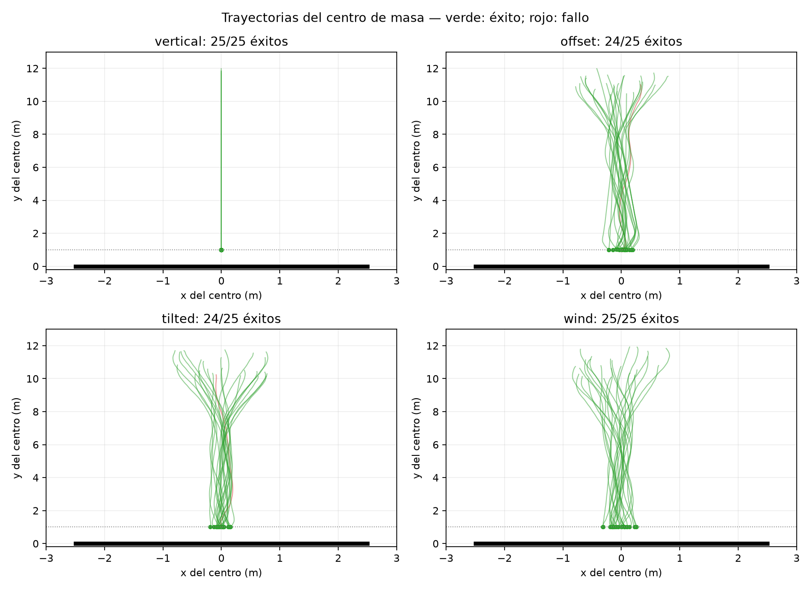
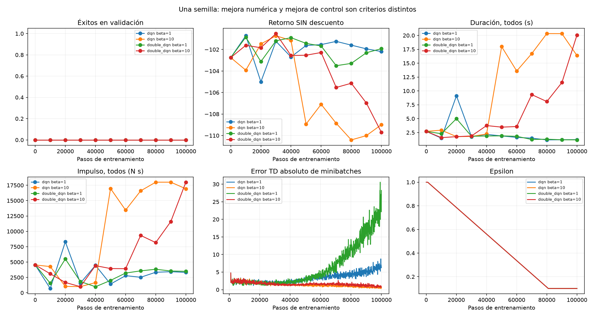
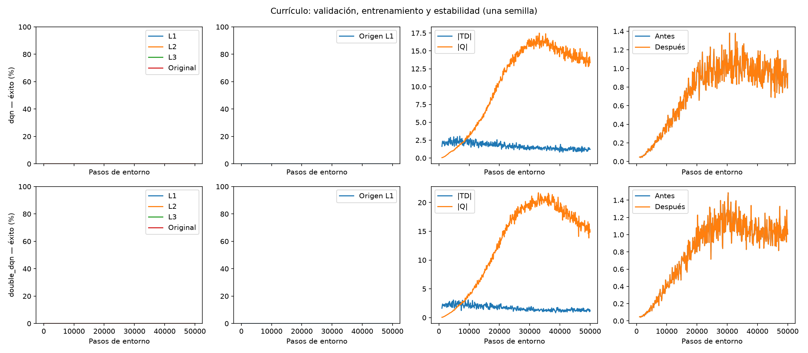
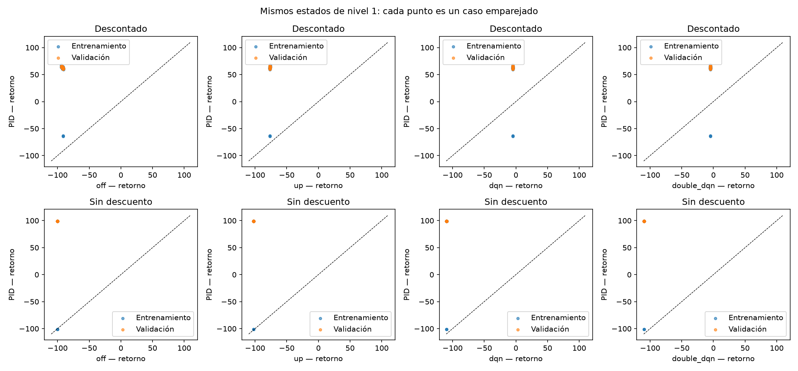
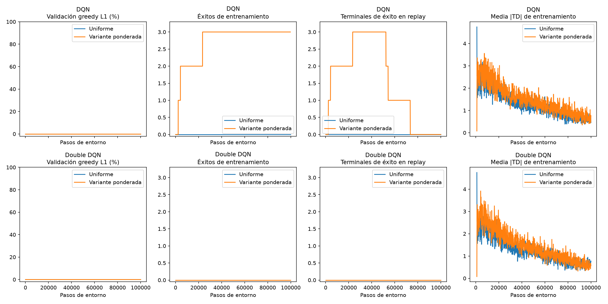
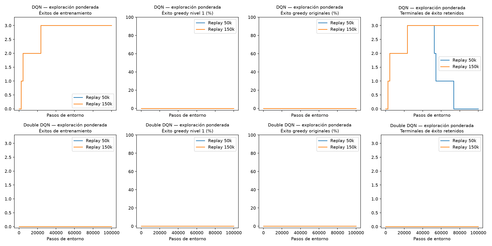

# Evidencia seleccionada del avance

Estado actual: la [publicación del repositorio](../../entrega/REPOSITORIO.md) incluye modelos de inferencia, las trazas de la evaluación común y el PDF. Las notas de disponibilidad siguientes describen las etapas históricas; no sustituyen el inventario público actual.

Cifras contrastadas el 2 de noviembre de 2026 con los CSV y metadatos locales,
sin ejecutar nuevos experimentos. [experimentos.csv](experimentos.csv) resume
los conjuntos y resultados finales. [pid_evaluaciones.csv](pid_evaluaciones.csv)
conserva una selección de columnas de los 32 casos de validación y 100 de prueba
PID, incluidos sus fallos. El [resumen PID original](../pid_test_summary.csv)
permanece en su ruta porque forma parte de las referencias congeladas por hash.
Las demás tablas pequeñas de `docs/` conservan sus rutas para mantener referencias
en informes y scripts; no se publican las trazas originales extensas.

## Resultados y experimentos sin aterrizajes RL

| Experimento | Pasos por agente | Validación final DQN / Double DQN | Resultado relevante |
|---|---:|---|---|
| Integración corta | 10 000 | 0/32 / 0/32 | Verifica integración; no demuestra aterrizaje |
| Exploración lenta | 100 000 | 0/32 / 0/32 | Ambos salen por techo; deriva optimista de Q |
| LR=0.0001 | 100 000 | 0/32 / 0/32 | Persiste el problema de control y calibración |
| SmoothL1 beta=10, LR=0.0001 | 100 000 | 0/32 / 0/32 | DQN sale por techo; Double DQN: 27 fuera de plataforma y 5 contactos inválidos |
| Currículo, nivel 1 | 50 000 | 0/128 / 0/128 | Parada predefinida; en nivel 1, 0/32 cada uno; no se entrenaron niveles 2/3 |

En los pilotos anteriores a la comparación de exploración, cero aterrizajes
en todos los registros de entrenamiento y validación RL revisados. Una semilla por algoritmo (42); los casos fijos de validación se
repiten entre puntos. En currículo, los 128 casos finales agrupan 32 originales y
32 por cada nivel 1/2/3; no son 128 casos de nivel 1. No se ejecutó prueba final RL.
El diagnóstico offline es una prueba de capacidad e interferencia sin episodios
nuevos; sus ajustes supervisados no son políticas de aterrizaje.

El PID obtuvo 31/32 en validación y **98/100 en prueba reservada**; 25/25 vertical,
24/25 desplazamiento, 24/25 inclinación y 25/25 viento. Los dos fallos superaron
el límite de velocidad angular. Los conjuntos PID y RL son diferentes.

## Figuras seleccionadas

Trayectorias PID sobre la prueba reservada; verde éxito, rojo fallo:

Ablación beta=10 frente a beta=1, ambas con LR=0.0001. El panel de éxito sigue
en cero; las curvas de TD y duración no demuestran aterrizaje:

Currículo detenido al terminar nivel 1. Validación e historial de entrenamiento
muestran cero éxitos. Se inspeccionaron también niveles 2/3 sin entrenarlos:

## Procedencia y archivos locales excluidos

[procedencia.json](procedencia.json) es un **registro local de auditoría**: hashes
de las fuentes consultadas, incluidas figuras copiadas sin alterar. Las rutas
`artifacts/` de ese registro no vienen incluidas en el repositorio. Tampoco se
incluyen los archivos mencionados por los manifiestos históricos
`configs/reference*.json` ni se garantiza que sus hashes antiguos correspondan
al código actual: algunos congelan versiones anteriores a nuevas etapas.

Los checkpoints, replay buffers, estados de reanudación, trazas por paso,
logs completos y figuras restantes se conservan localmente bajo `artifacts/`,
excluidos mediante `.gitignore`. Las tablas y figuras de esta carpeta sí están
publicadas. Los comandos de los informes que leen rutas históricas necesitan
esos archivos locales; los comandos básicos de README generan salidas nuevas.

## Auditoría de recompensa del nivel 1 — 3 de noviembre de 2026

Se ejecutaron 800 episodios emparejados (cinco conductas, 128 casos de
entrenamiento y 32 de validación del nivel 1), sin nuevo entrenamiento.
PID aterrizó en 157/160; cada uno de esos aterrizajes recibió mayor retorno que
las otras cuatro conductas desde el mismo estado, con y sin descuento.
No se creó v2. El [informe](../auditoria_recompensa.md) documenta también
los tres fallos PID, la preferencia por demorar fallos entre los agentes fallidos,
la señal por paso y el experimento alternativo que quedó preparado en esa etapa.

[Tabla por conducta y split](recompensa_v1_conductas.csv),
[todos los estados emparejados](recompensa_v1_por_estado.csv),
[diferencias y percentiles](recompensa_v1_diferencias.csv),
[señales PID](recompensa_v1_senales_pid.csv),
[escalas por paso](recompensa_v1_escalas.csv) y
[procedencia propia](recompensa_v1_procedencia.json).

## Comparación de exploración — 3 de noviembre de 2026

Cuatro ejecuciones desde cero, cada una de 100 000 pasos: DQN/Double DQN con
exploración uniforme y con la variante ponderada. DQN variante encontró tres
éxitos entrenando con epsilon (pasos 2324/4257/23468); los otros tres agentes, cero.
Todas las políticas obtuvieron 0/128 en cada validación greedy. Al finalizar no
quedaban terminales de éxito en ningún replay. No se ejecutó la prueba final.

[Informe y definición del método](../experimento_exploracion.md),
[resultados](exploracion_resultados.csv), [presupuesto igual](exploracion_presupuesto_igual.csv),
[acciones por modo](exploracion_acciones.csv), [contactos](exploracion_contactos.csv),
[causas y consumo](exploracion_resultados_por_causa.csv),
[Q/TD](exploracion_q_td.csv), [gradientes](exploracion_gradientes.csv) y
[procedencia](exploracion_procedencia.json). Una semilla; no se demostró una
política funcional ni superioridad general.

## Capacidad del replay 150k — misma exploración ponderada

Dos corridas nuevas de 100k, semilla 42, comparadas con las referencias de
capacidad 50k. DQN reprodujo exactamente los tres éxitos tempranos y conservó
3 terminales/56 transiciones de esos episodios; los terminales se muestrearon
132 veces y el conjunto completo 2400 (frente a 102/1948 en la referencia).
Ningún modelo obtuvo éxitos greedy en L1 ni en los originales. Double DQN
siguió sin éxitos de entrenamiento. [Informe y comandos](../ablacion_replay150k.md).

[Resultados](replay150k_resultados.csv), [retención/exposición](replay150k_retencion_exposicion.csv),
[usos por transición](replay150k_exposicion_por_transicion.csv),
[Q/TD fijos](replay150k_q_td_fijos.csv),
[usos reales de terminales exitosos](replay150k_muestreos_terminales_exitosos.csv),
[causas y contactos](replay150k_resultados_por_causa.csv) y
[procedencia](replay150k_procedencia.json).

La [recuperación asistida](../recuperacion_agente.md) añade `recuperacion_resultados.csv`, `recuperacion_causas.csv`, `recuperacion_entrenamiento.csv`, `recuperacion_curvas.png` y `recuperacion_trayectorias.png`. No mezclar estos resultados con DQN desde cero: usan demostraciones PID de entrenamiento. Datos crudos/checkpoints y las dos intervenciones permanecen separados en `artifacts/recovery_v1/`.

La [evaluación común del alcance](../evaluacion_alcance.md), congelada antes de ejecutar, añade `alcance_resultados.csv`, `alcance_metricas.csv`, `alcance_fallos.csv`, pares contra PID/viento y figuras. Incluye100 casos reservados previos y288 complementarios independientes; no sustituye los resultados históricos. La asistencia por demostraciones está identificada como componente metodológico adicional.
